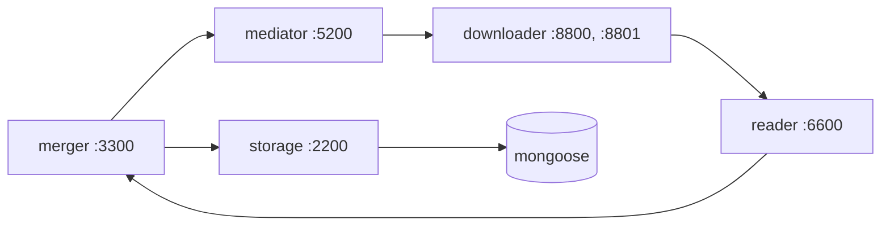

# Crawler

Hệ thống thu thập trang web và tài liệu của Đại học Bách khoa Hà Nội (HUST), gồm năm khối theo
slide của thầy: **reader, downloader, mediator, merger, storage** và Mongo (**mongoose**). Folder này là một
project Python với một package `crawler` và một lệnh `crawler`: năm khối chạy trong một tiến trình
(`crawler crawl run`) hoặc thành năm dịch vụ HTTP/JSON theo slide (`crawler serve <khối>`, dựng bằng Docker).
Lập chỉ mục và tìm kiếm nằm ở project [`lucene/`](../lucene/README.md) (chưa đọc dữ liệu này).
Mọi lệnh chạy trong `crawler/`.



Giao diện từng khối, luồng dữ liệu và cách thay khối bằng khối của nhóm khác: [docs/services.md](docs/services.md).

## Hai cách chạy, một bộ dữ liệu

| Cách chạy | Lệnh | Khi nào dùng |
|---|---|---|
| **Một tiến trình** | `uv run crawler crawl run` | crawl thật: năm khối gọi hàm trực tiếp trong một tiến trình, không tốn HTTP nội bộ, 64 URL tải song song |
| **Năm dịch vụ theo slide** | `docker compose up -d --build` | nộp bài, ghép với khối của nhóm khác qua HTTP; mỗi container chạy `crawler serve <khối>` |

Hai cách chạy dùng chung **một code** (`src/crawler/`) và **một bộ dữ liệu**:

| Dữ liệu | Ở đâu |
|---|---|
| Hàng đợi, lịch crawl lại, `ETag`/`Last-Modified` (mediator) | `data/state/mediator.sqlite3` |
| URL đã biết, chủ nội dung, fingerprint thay đổi, host được phép lan (merger) | `data/state/merger.sqlite3`, `data/state/outbox.jsonl` |
| Trang, ảnh, tài liệu, đồ thị liên kết | MongoDB (`html`, `picture`, `other`, `graph`), volume `data_pipeline_mongodb_data` |
| Cache LlamaParse | `data/enrichment/cache/` |
| HTML đã lưu (cho `reextract`), tệp gốc của tài liệu | `data/crawl/`, `data/enrichment/files/` |

Chạy bằng cách nào cũng **tiếp tục** đúng chỗ cách kia dừng: trang đã có không tải lại, chỉ đến lịch kiểm tra
định kỳ. Mỗi lúc chỉ một cách chạy được ghi vào trạng thái: mỗi file SQLite có một khoá; cách thứ hai báo
`Error: ... is in use by <ai đang chạy>` và thoát mã 2.

## Crawl trong một tiến trình

```bash
uv sync && uv run playwright install chromium
docker compose up -d mongoose                        # chỉ Mongo
uv run crawler crawl run                             # chạy tới khi hết URL đến hạn
uv run crawler crawl run --forever                   # chạy mãi như dịch vụ (cả crawl lại định kỳ)
uv run crawler crawl run --seeds my-seeds.txt        # mầm khác file mặc định
uv run crawler seeds add soict.hust.edu.vn https://ctsv.hust.edu.vn/tin-tuc/abc
uv run crawler pictures fetch                        # tải ảnh của các bản ghi picture
```

**Mầm** (`seeds_file` trong `config/merger.yaml`, mặc định `config/domains/active.txt`): mỗi dòng một mục,
bỏ dòng trống và `#`.

- Một **host** (`soict.hust.edu.vn`): bắt đầu từ `https://soict.hust.edu.vn/`.
- Một **URL** (`https://ctsv.hust.edu.vn/tin-tuc/abc`): bắt đầu từ chính URL đó (như slide).
- Từ mầm, hệ thống **lan ra nhưng chỉ trong host của mầm**: `soict.hust.edu.vn` không gồm `hust.edu.vn` hay
  `www.soict.hust.edu.vn`. Các host đã từng là mầm được nhớ trong trạng thái, nên lần chạy sau vẫn lan đúng.
- Mầm đã biết giữ nguyên lịch (không tải lại). Dòng sai bị bỏ qua kèm cảnh báo có số dòng.

**Nhịp tải** (`config/crawl.yaml`, ghi đè `config/mediator.yaml`): 64 URL song song, tối đa 4 URL một host,
AutoThrottle (khoảng chờ một host bắt đầu 0,25 s, giãn tới 5 s khi host trả lời chậm), như pipeline Scrapy cũ.
Tải lỗi thử lại 3 lần (chờ 2, 4, 8 s). Ctrl+C dừng sạch: URL đang tải quay lại hàng đợi, URL mới chưa xếp hàng
vào outbox.

**Crawl lại theo thay đổi.** Tới lịch, trang được tải lại bằng request có điều kiện (`If-None-Match`,
`If-Modified-Since`); trang không đổi chỉ được cập nhật `checked_at` và dãn lịch, trang đổi được ghi lại và rút
ngắn lịch. Trang chủ và trang mục (`/tin-tuc`, `/thong-bao`, ...) luôn crawl lại mỗi ngày để tìm bài mới. Chi
tiết: [docs/architecture.md](docs/architecture.md#4-crawl-lại-theo-thay-đổi).

## Năm dịch vụ bằng Docker

```bash
docker compose up -d --build        # 5 khối + MongoDB (compose project `services`, image `crawler:latest`)
docker compose logs -f mediator     # theo dõi
curl -X POST localhost:5200/add -d '{"urls": ["https://ctsv.hust.edu.vn/"]}'
```

Các container dùng chung `data/state/` và volume Mongo với `crawl run`, nên hai cách chạy nối tiếp nhau được.
Cổng, biến môi trường, chạy từng khối không cần Docker (`uv run crawler serve <khối>`): [docs/services.md](docs/services.md#chạy).

## Tải ảnh

Khi lưu một trang, storage tạo bản ghi `picture` (chưa có `b64`) cho mỗi ảnh trong khối nội dung. Ảnh được tải
riêng, không trong lúc crawl:

```bash
uv run crawler pictures fetch                      # các ảnh chưa có b64 và chưa lỗi
uv run crawler pictures fetch --retry-errors       # thử lại cả ảnh đã lỗi
uv run crawler pictures fetch --workers 32 --per-host 1
```

- Tải bằng HTTP thường, không qua trình duyệt, không tải lại trang HTML.
- `--workers` (mặc định 64): số ảnh tải cùng lúc trên mọi host; `--per-host` (mặc định 2): trên một host.
- Mỗi host cách nhau 0,25 s giữa hai lần tải; host trả `429`/`503` hoặc hết thời gian chờ thì khoảng chờ nhân đôi
  (tới 5 s) và ảnh được thử lại (3 lần); tải được thì khoảng chờ giảm dần về 0,25 s.
- Ảnh lớn hơn 2 MB ghi `error = "too_large"`; phản hồi rỗng `empty`; phản hồi không phải ảnh `not_image` (ảnh gửi
  kèm `application/octet-stream` vẫn được nhận nếu các byte đầu là JPEG, PNG, GIF, WebP hay BMP); lỗi HTTP
  `http_<mã>`; lỗi mạng `timeout` hoặc `unreachable`.
- Host thiếu chứng chỉ trung gian (như `ts.hust.edu.vn`) được tải lại không kiểm tra chứng chỉ; kiểm tra địa chỉ
  công khai, loại nội dung và cỡ ảnh vẫn giữ.
- Mỗi ảnh được ghi ngay khi xong, nên dừng giữa chừng rồi chạy lại thì tiếp tục từ chỗ dừng. Cuối cùng in số ảnh
  theo kết quả (`ok`, `too_large`, ...).

Không chạy cùng lúc với crawl trên cùng host.

## Cài đặt để phát triển

Cần Python 3.13 và [uv](https://docs.astral.sh/uv/).

```bash
uv sync                                # gồm cả nhóm dev (pytest, ruff, pyrefly, pre-commit)
uv run playwright install chromium     # trình duyệt cho trang JavaScript
```

## Lệnh

| Lệnh | Việc làm |
|---|---|
| `crawl run [--seeds FILE] [--forever] [--config FILE]` | crawl bằng năm khối trong một tiến trình |
| `seeds add HOST_HOẶC_URL...` | thêm mầm (host vào phạm vi, URL vào hàng đợi) mà không crawl |
| `serve reader\|downloader\|mediator\|merger\|storage` | chạy một khối thành dịch vụ HTTP ([docs/services.md](docs/services.md)) |
| `pictures fetch [--workers N] [--per-host N] [--retry-errors]` | tải ảnh của collection `picture` thành base64 |
| `reextract [--crawl DIR] [--merger URL]` | chạy lại bộ trích xuất trên HTML đã lưu ở `data/crawl/` và lưu lại (trong một tiến trình, giữ khoá như `crawl run`; với `--merger` thì gửi sang dịch vụ merger). Dùng khi đổi thuật toán trích xuất, không tải lại trang |
| `corpus package\|verify\|query\|publish\|pull` | đóng gói MongoDB thành corpus, truy vấn đồ thị, Kaggle ([docs/corpus.md](docs/corpus.md)) |
| `domains audit` | kiểm tra host nào còn trả nội dung ([docs/domains.md](docs/domains.md)) |
| `eval extraction` | chấm điểm thuật toán trích xuất nội dung |

| Mã thoát | Khi nào |
|---|---|
| 0 | thành công |
| 1 | hệ thống bên ngoài lỗi (MongoDB, Playwright, SQLite, `kaggle` CLI) hoặc tiến trình con thất bại; in một dòng `Error: ...` |
| 2 | sai cách dùng: thiếu/sai tham số, file không tồn tại, cấu hình không hợp lệ |
| 3 | `corpus verify`: corpus không hợp lệ |
| 130 | bị ngắt (Ctrl-C) |

## Cấu hình

| Vị trí | Nội dung |
|---|---|
| `.env` | `LLAMAPARSE_KEY1..n`, `KAGGLE_API_TOKEN`. Không commit |
| `config/mediator.yaml`, `downloader.yaml`, `reader.yaml`, `merger.yaml` | cấu hình từng khối, dùng cho cả hai cách chạy ([docs/services.md](docs/services.md#cấu-hình)) |
| `config/crawl.yaml` | nhịp của `crawl run` (ghi đè `mediator.yaml`) |
| `config/pipeline.yaml` | MongoDB cho các lệnh `corpus` và `pictures fetch` |
| `config/domains/` | `all.txt`, `active.txt`, `status.jsonl` |
| `config/kaggle-dataset.json`, `config/corpus.lock.json` | metadata dataset Kaggle và bản đã ghim |

Dữ liệu các khối lưu lại (Mongo, SQLite của mediator và merger, gói corpus, dữ liệu thô): [docs/data-schema.md](docs/data-schema.md).

## Phát triển

```bash
uv run pytest -q                     # bỏ qua test cần Docker (marker `docker`)
uv run pytest -q -m docker           # test với MongoDB thật (`docker compose up -d mongoose`)
uv run ruff check . && uv run ruff format --check .
uv run pyrefly check                 # kiểm tra kiểu (preset strict)
uv run pre-commit install            # cài hook (ruff, pyrefly khi commit; pytest khi push)
```

Package theo clean architecture, chia theo lớp (`domain`, `application`, `infra`) rồi theo khối; các khối không
import lẫn nhau. Hai cửa vào ngang hàng: `api/` (một module HTTP mỗi khối) và `cli/`. Chỉ `cli/pipeline/` (cho
`crawl run`, `reextract`) nối các khối bằng lời gọi hàm; năm dịch vụ nối chúng qua HTTP. Quy tắc phụ thuộc được
kiểm tra tự động (`tests/unit/test_architecture.py`), xem [docs/architecture.md](docs/architecture.md).

## Tài liệu

| Tài liệu | Nội dung |
|---|---|
| [docs/system-design.md](docs/system-design.md) | tóm tắt slide của thầy |
| [docs/services.md](docs/services.md) | các khối, endpoint, luồng dữ liệu, chạy bằng Docker, thay khối |
| [docs/architecture.md](docs/architecture.md) | cấu trúc package, quy tắc phụ thuộc, crawl lại theo thay đổi, yêu cầu của thầy |
| [docs/data-schema.md](docs/data-schema.md) | MongoDB, trạng thái các khối, gói corpus, dữ liệu thô |
| [docs/corpus.md](docs/corpus.md) | đóng gói, Kaggle |
| [docs/domains.md](docs/domains.md) | danh sách host và kiểm tra host |
