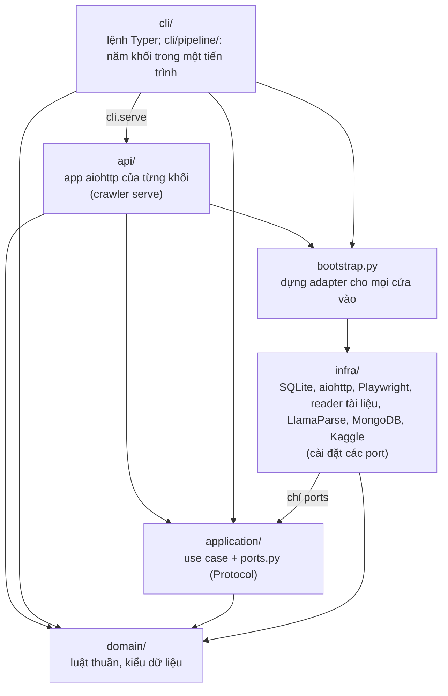
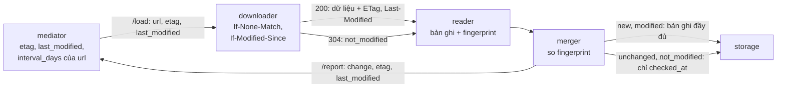
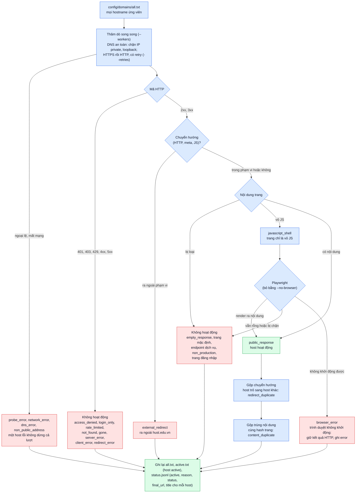
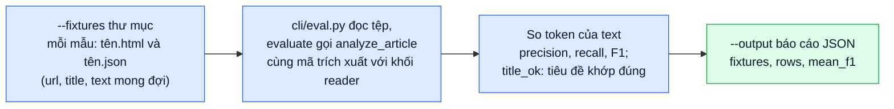

# Kiến trúc

## 1. Các khối dịch vụ

Package `crawler` chứa năm khối trong slide của thầy (reader, downloader, mediator, merger, storage, cùng Mongo)
và hai cách chạy chúng trên cùng một code và cùng một bộ dữ liệu:

- **Một tiến trình** (`crawler crawl run`, phần `cli/pipeline/`): các khối gọi nhau bằng hàm.
  Tác dụng: chạy và gỡ lỗi cả hệ thống trên một máy bằng một lệnh, không cần Docker.
- **Năm dịch vụ HTTP/JSON** (`crawler serve <khối>`, phần `api/`, dựng bằng `docker-compose.yaml` ở gốc repo): đúng endpoint và
  cổng của slide, mỗi khối một container. Tác dụng: nhóm có bản demo đầy đủ từ đầu đến cuối mà không phải chờ các
  nhóm khác, và thay được từng khối bằng khối của nhóm khác khi ghép ([services.md](services.md)).

Hai cách chạy dùng chung use case và luật của từng khối; chỉ cách nối các khối khác nhau (lời gọi hàm hay
HTTP client), nên lọc link, lập lịch, AutoThrottle, crawl lại theo thay đổi và schema Mongo luôn giống nhau.

### 1.1. Từng khối: làm gì, tác dụng, cách làm, công nghệ

**1. reader** (`reader`, cổng 6600)
- *Làm gì:* nhận dữ liệu đã tải (url, định dạng, nội dung) và bóc tách thành bản ghi.
- *Tác dụng:* biến HTML, PDF, Word, ... thành văn bản sạch có cấu trúc để lập chỉ mục và tìm kiếm.
- *Cách làm:* với trang `html`, thuật toán tìm khối nội dung (`domain/reader/extract/content.py`): ưu tiên thẻ
  `<article>`, `<main>`; không có thì xét các phần tử có `id`/`class` gợi ý nội dung (`content`, `news`, `post`,
  ...), loại `menu`, `footer`, `sidebar`, ...; chấm điểm mỗi ứng viên = độ dài chữ + 80 × số đoạn `<p>` − độ dài
  chữ trong link, chọn điểm cao nhất. Từ đó lấy tiêu đề, ngày đăng, tác giả, nội dung, ảnh, và liên kết đi ra kèm
  câu hoàn chỉnh chứa thẻ `a`. Với tài liệu, đọc văn bản bằng reader theo định dạng; trang PDF là ảnh quét thì
  gửi LlamaParse để OCR khi bật trong `config/reader.yaml` (có cache, hết hạn mức thì giữ phần chữ đọc được).
  Mỗi bản ghi kèm `fingerprint` (dấu vân tay nội dung, xem mục 4).
- *Công nghệ:* `lxml` (phân tích HTML), PyMuPDF (PDF), `python-docx`, `python-pptx`, `openpyxl`, `xlrd` (Word,
  PowerPoint, Excel), LibreOffice (đổi `.doc`, `.ppt`, `.odt`, `.rtf`, ... sang định dạng mới), LlamaParse
  (`llama-cloud`, OCR đám mây).

**2. downloader** (`downloader`, cổng 8800)
- *Làm gì:* nhận một url, tải nội dung, gửi sang reader.
- *Tác dụng:* lấy được cả trang tĩnh, trang dựng bằng JavaScript và tệp tài liệu.
- *Cách làm:* tải bằng HTTP trước, có điều kiện khi mediator gửi kèm `etag`/`last_modified` (mục 4); trang chỉ
  là "vỏ" JavaScript thì mở lại bằng trình duyệt không giao diện để chạy script. Mỗi bước chuyển hướng phải tới
  địa chỉ IP công khai (chặn IP nội bộ). Nhận diện trang đăng nhập, CAPTCHA, trang 404 giả
  (`domain/downloader/access.py`) để không đưa rác vào corpus. Mỗi node tải một url một lúc và báo
  `"đang chờ"`/`"đang bận"` qua `/ping`.
- *Công nghệ:* `aiohttp` (HTTP bất đồng bộ), Playwright với Chromium headless (thay cho Puppeteer + Chrome trong
  slide, cùng cơ chế nhưng có thư viện Python).

**3. mediator** (`mediator`, cổng 5200)
- *Làm gì:* giữ hàng đợi url, quyết định url nào gửi lúc nào, cho node downloader nào.
- *Tác dụng:* không dồn tải lên một website của trường, chia đều việc cho các node, tự thu thập lại trang đã
  thay đổi.
- *Cách làm:* hàng đợi lưu trên đĩa; mỗi host có khoảng chờ giữa hai lần gửi, tự giãn khi host trả lời chậm
  (AutoThrottle, như Scrapy); chọn node theo vòng (round robin), node lỗi được cho nghỉ. Url gửi xong được hẹn
  lại theo loại (`hub` 1 ngày, `page` 7 ngày, `document` 30 ngày), rồi lịch được chỉnh theo kết quả merger báo về
  (mục 4).
- *Công nghệ:* SQLite (hàng đợi), `aiohttp` (gọi `/ping`, `/load`).

**4. merger** (`merger`, cổng 3300)
- *Làm gì:* nạp url mầm; nhận bản ghi từ reader, gửi bản ghi sang storage, url mới và kết quả mỗi lần tải sang
  mediator.
- *Tác dụng:* giữ việc thu thập trong miền hust, không tải lại url đã biết, không sa vào bẫy url sinh trang vô
  hạn, không lưu trùng một nội dung, không ghi lại trang không đổi.
- *Cách làm:* chỉ theo link trong đúng các host mầm (`config/domains/active.txt`); phân loại link để bỏ đăng
  nhập, tìm kiếm, lịch, RSS, bộ lọc, ... (`domain/merger/link_policy.py`); nhớ url đã thấy; trang có cùng
  băm SHA-256 nội dung với trang khác chỉ lưu bản rút gọn có `duplicate_of`; so `fingerprint` với lần trước để
  xếp mỗi lần tải vào `new`/`modified`/`unchanged`/`not_modified` (mục 4); gom url mới thành lô (500 url hoặc 1
  giây). Gửi không được thì ghi vào outbox và gửi lại sau, nên tắt một khối không mất dữ liệu.
- *Công nghệ:* SQLite (url đã thấy, chủ nội dung, fingerprint), tệp JSONL (outbox), `aiohttp`.

**5. storage** (`storage`, cổng 2200) và **6. Mongo** (`mongoose`)
- *Làm gì:* nhận bản ghi và ghi vào MongoDB theo format chung của thầy (`html`, `picture`, `other`, `graph`).
- *Tác dụng:* một nơi chứa corpus để lập chỉ mục và tìm kiếm.
- *Cách làm:* ba việc của slide: upsert theo `url` vào `html` (trang) hoặc `other` (tài liệu, kèm `origin`); thay
  toàn bộ cạnh `graph` (nguồn → đích, kèm văn bản liên kết `intro`) của trang đó, nên thu thập lại không sinh bản
  trùng; tính lại `html.intro` của trang và của các đích đã có bản ghi. Trang `html` còn sinh bản ghi `picture`
  (chưa có `b64`) cho ảnh chưa gặp; ảnh được tải bằng `crawler pictures fetch`. Lần tải `unchanged`/`not_modified`
  chỉ cập nhật `checked_at`. Lược đồ ở [data-schema.md](data-schema.md).
- *Công nghệ:* MongoDB 8, `pymongo`.

**Công cụ thêm của nhóm** (không có trong slide)
- `pictures fetch`: tải ảnh của collection `picture`, lưu base64 ([README](../README.md#tải-ảnh)). Công nghệ:
  `aiohttp`.
- `domains audit`: thăm dò danh sách host của trường để biết host nào còn trả nội dung công khai, làm url mầm
  (mục 5). Công nghệ: `aiohttp`, Playwright.
- `eval extraction`: chấm điểm thuật toán tìm khối nội dung trên trang mẫu có đáp án (mục 6).
- `corpus package/publish/pull`: xuất bốn collection Mongo ra tệp JSONL và gói các thư mục `data/`, có checksum,
  đưa lên Kaggle để chia sẻ dữ liệu; máy mới `pull` là có lại Mongo và `data/` ([corpus.md](corpus.md)).
  Công nghệ: `pymongo`, `tarfile`, Kaggle CLI.

Service mediator dùng chung cho cả lớp nằm ở repo của lớp
([`bangoc/hust.edu.vn-2026`, `crawler/mediator`](https://github.com/bangoc/hust.edu.vn-2026/tree/main/crawler/mediator)),
được copy từ khối `mediator` này nhưng bỏ AutoThrottle và `per_host_concurrency` để các nhóm dễ đọc. Ở đó mỗi
host chỉ có khoảng chờ cố định `host_delay_seconds`.

### 1.2. Công nghệ chung

| Công nghệ | Dùng làm gì | Vì sao |
|---|---|---|
| Python 3.13, `asyncio` | ngôn ngữ của mọi khối | một tiến trình chờ được nhiều request mạng cùng lúc |
| `aiohttp` | HTTP server của các dịch vụ và HTTP client | bất đồng bộ, dùng chung cho cả hai chiều |
| SQLite | trạng thái của mediator và merger | có sẵn trong Python, giữ được qua khởi động lại, không cần thêm server |
| MongoDB | corpus (`html`, `picture`, `other`, `graph`) | slide yêu cầu; lưu bản ghi JSON trực tiếp |
| Docker, Docker Compose | chạy năm khối và Mongo, mỗi khối một container | một lệnh dựng cả hệ thống trên máy bất kỳ |
| Typer | lệnh `crawler` | khai báo lệnh và tham số bằng kiểu Python |
| `uv` | cài thư viện, khoá phiên bản (`uv.lock`) | mọi người cài đúng cùng phiên bản |
| pytest, ruff, pyrefly | kiểm thử, kiểm tra phong cách, kiểm tra kiểu (strict) | pre-commit chạy ruff, pyrefly khi commit và pytest khi push |

## 2. Cấu trúc package

Một project `crawler/`, một package `crawler` (trong `src/`) với một lệnh `crawler`, tổ chức theo clean
architecture và **chia theo lớp trước**: ở gốc có ba lớp (`domain`, `application`, `infra`), hai cửa vào ngang
hàng (`api`, `cli`) và `bootstrap.py`. Trong mỗi lớp, code chia theo ngữ cảnh: năm khối `reader`, `downloader`,
`mediator`, `merger`, `storage`, cùng `corpus` (đóng gói, Kaggle), `hosts` (`domains audit`) và `shared` (phần
dùng chung).

Tác dụng của cách chia này: luật nghiệp vụ (`domain`) không phụ thuộc SQLite, HTTP hay Mongo, nên cùng một luật
chạy được trong một tiến trình lẫn trong năm dịch vụ, và test được bằng bản giả trong bộ nhớ mà không cần mạng.
Đổi công nghệ (vd. SQLite sang Redis) chỉ phải viết lại một adapter trong `infra`.



Quy tắc phụ thuộc (kiểm tra tự động bằng `tests/unit/test_architecture.py`):

1. **Lớp chỉ trỏ vào trong:** `domain` ← `application` ← `infra`. `domain` không import lớp nào khác;
   `application` chỉ dùng `domain`; `infra` dùng `domain` và chỉ `application/<ngữ cảnh>/ports.py` của chính ngữ
   cảnh đó. `domain` không import module I/O (`sqlite3`, `aiohttp`, `pymongo`, `playwright`, `llama_cloud`,
   `subprocess`, `os`, `yaml`, `socket`, ...) và không đọc ghi tệp (`open`, `read_text`, `write_text`, `mkdir`,
   `glob`, ...): lớp ngoài đọc tệp rồi đưa dữ liệu vào.
2. **Các ngữ cảnh không import lẫn nhau:** năm khối, `corpus` và `hosts` chỉ dùng phần của chính nó và `shared`;
   `shared` chỉ dùng `shared`.
3. **Hai cửa vào không dựng adapter:** `api` và `cli` không import `infra`, lấy adapter qua `bootstrap.py`.
   `bootstrap.py` là nơi duy nhất dựng adapter hạ tầng (SQLite, HTTP, Playwright, Mongo, ...) và không import
   `api`, `cli`.
4. **`api/<khối>.py` chỉ nói cho khối của nó:** dùng khối đó, `shared`, `api/common.py` và `bootstrap`; `api`
   không import `cli`. `cli/serve.py` (lệnh `crawler serve`) bật app từ `api`.
5. **Chỉ `cli/pipeline/` nối nhiều khối:** nó cài port của khối này bằng use case của khối kia (`LocalNodes`,
   `DirectReaderClient`, `DirectMergerClient`, `DirectServiceClient`) và không import phần còn lại của `cli`.
6. Mọi module nằm trong `<lớp>/<ngữ cảnh>/`, `api/`, `cli/` hoặc là `bootstrap.py`. Use case nhận adapter qua
   tham số.

```text
src/crawler/
  domain/
    shared/        url, links (normalize_url), assets (nhận diện tài liệu), protocol (chuỗi và bản ghi /add),
                   navigation (trang mục), change (new/modified/...), validators (etag, last_modified),
                   hostnames, refs, errors, config
    mediator/      models, kinds (hub/page/document), scheduling (lịch thích nghi), rotation, throttle
    downloader/    access (cổng đăng nhập/CAPTCHA/soft 404), formats, models
    reader/        extract/ (thuật toán tìm khối nội dung, fingerprint, evaluation), records, models, merge,
                   serializers, cache_key, cloud_pages, cloud_errors, key_pool, config
    merger/        link_policy, links, seeds, batching, records, content, change (phân loại), config
    storage/       documents, intro (cách tính html.intro), pictures (format, base64)
    corpus/        manifest, records, kaggle_metadata
    hosts/         classify, canonical, models
  application/<ngữ cảnh>/   use case + ports.py
  infra/
    shared/        settings, env, network, files, http_client, sqlite, lease (một người ghi trạng thái)
    mediator/      sqlite_queue, http_downloader, config_file
    downloader/    http_getter, browser, playwright_driver, reader_client, config_file
    reader/        readers/, llamaparse, cache, job_log, merger_client, raw_pages, config_file
    merger/        sqlite_state, outbox, service_client, config_file
    storage/       mongo, image_getter
    corpus/        files/corpus_files, mongo, kaggle_cli
    hosts/         http_probe, browser_probe, report_files
  api/             reader, downloader, mediator, merger, storage (app aiohttp mỗi khối), common
  cli/             main, crawl (crawl run, seeds add), serve, pictures, reextract, corpus, domains, eval,
                   context, errors
    pipeline/      adapters (port bằng lời gọi hàm), crawl (vòng chạy của crawl run và reextract)
  bootstrap.py
```

| Ngữ cảnh | Port (trong `application/<ngữ cảnh>/ports.py`) | Adapter |
|---|---|---|
| `mediator` | `UrlQueue`, `Downloader`, `Clock` | `SqliteUrlQueue`, `HttpDownloader` (dịch vụ), `LocalNodes` (một tiến trình) |
| `downloader` | `PageGetter`, `Renderer`, `ReaderClient` | `AiohttpPageGetter`, `PlaywrightRenderer`, `HttpReaderClient` (dịch vụ), `DirectReaderClient` (một tiến trình) |
| `reader` | `LocalReader`, `CloudReader`, `ParseCache`, `CloudJobLog`, `MergerClient`, `RawPages` | `LocalReaderAdapter`, `LlamaParseCloud`, `FileParseCache`, `LoggedCloudJobs`, `HttpMergerClient` (dịch vụ), `DirectMergerClient` (một tiến trình), `SqliteRawPages` |
| `merger` | `SeenUrls`, `ContentOwners`, `ScopeHosts`, `Fingerprints` (`MergerState`), `Outbox`, `ServiceClient` | `SqliteMergerState`, `JsonlOutbox`, `HttpServiceClient` (dịch vụ), `DirectServiceClient` (một tiến trình) |
| `storage` | `CorpusStore`, `PictureStore`, `ImageGetter` | `MongoCorpusStore`, `MongoPictureStore`, `AiohttpImageGetter` |
| `corpus` | `CorpusFiles`, `CorpusDatabase`, `DatasetPublisher` | `LocalCorpusFiles`, `MongoCorpusDatabase`, `KaggleCli` |
| `hosts` | `HostProber`, `BrowserProber`, `AuditReports` | `HttpHostProber`, `PlaywrightBrowserProber`, `FileAuditReports` |

Test có cùng cấu trúc (`tests/unit/<lớp>/<ngữ cảnh>/`, `tests/unit/api/`, `tests/unit/cli/`) và dùng bản giả
trong `tests/fakes/`; `tests/fakes/test_fakes_satisfy_ports.py` kiểm tra mỗi bản giả vẫn khớp port của nó.
`tests/integration/test_crawl_run.py` cho `crawl run` thu thập một website giả lập cục bộ
(`tests/integration/services/site.py`); `tests/integration/test_end_to_end.py` dựng năm dịch vụ trên cổng ngẫu
nhiên và thu thập cùng website đó. Cả hai so với cùng kết quả mong đợi (`EXPECTED_*` trong `site.py`), nên hai
cách chạy không thể lệch nhau.

## 3. Yêu cầu của thầy và nơi đáp ứng

| # | Yêu cầu | Nơi đáp ứng | Collection Mongo |
|---|---|---|---|
| Y1 | Thuật toán tìm khối nội dung | `domain/reader/extract/`, báo cáo `crawler eval extraction` | |
| Y2 | Trang: tiêu đề, ngày đăng, tác giả, nội dung | khối reader, bản ghi `html` | `html` |
| Y3 | Tài liệu: nội dung văn bản, trang dẫn tới | khối reader (reader cục bộ, LlamaParse), `origin` do storage đặt | `other` |
| Y4, Y6 | Đồ thị nguồn → đích kèm văn bản liên kết (câu hoàn chỉnh chứa thẻ `a`) | `out-links` của bản ghi (`domain/reader/extract/links.py` `anchor_sentence`), khối storage | `graph` |
| Y5 | Ảnh của trang | trường `images` của `html`; collection `picture` (storage tạo, `crawler pictures fetch` tải `b64`) | `html`, `picture` |
| Y7 | MongoDB theo format chung của slide | khối storage, [data-schema.md](data-schema.md) | `html`, `picture`, `other`, `graph` |
| Y8 | Chia sẻ dữ liệu của project | `corpus package/publish/pull`, `config/corpus.lock.json` ([corpus.md](corpus.md)) | |

## 4. Crawl lại theo thay đổi

Mỗi url được crawl lại theo lịch; lần crawl lại phân biệt trang đổi, trang không đổi và trang site báo không đổi
(`304`). Chạy giống nhau ở cả hai cách chạy: ở năm dịch vụ qua HTTP, ở một tiến trình qua lời gọi hàm trong
`cli/pipeline/`.



1. mediator giữ `etag` và `last_modified` của lần tải trước, gửi kèm url trong `/load`.
2. downloader gửi `If-None-Match` / `If-Modified-Since` khi có. Phản hồi `304`: không tải nội dung, không bóc
   tách, url được chuyển đi là `not_modified`. Phản hồi `200`: `ETag` / `Last-Modified` của phản hồi đi cùng dữ
   liệu sang reader (bản mở bằng Playwright giữ hai giá trị của lần tải HTTP thường).
3. reader gắn `fingerprint` của văn bản (`change_fingerprint`: bỏ chữ số, tên tháng, dòng đếm lượt xem, nên ngày
   giờ hay bộ đếm đổi không bị tính là đổi), cùng url mediator đã xếp hàng và hai giá trị trên.
4. merger giữ fingerprint gần nhất của từng url (bảng `fingerprints` trong `merger.sqlite3`) và xếp mỗi lần tải:

| Loại | Khi nào | storage | Lan link | mediator |
|---|---|---|---|---|
| `new` | url chưa có fingerprint | ghi bản ghi, cạnh, `intro`, ảnh | có | khoảng cách gốc của loại url |
| `modified` | fingerprint khác lần trước | ghi lại bản ghi, cạnh, `intro`, ảnh mới | có | chia đôi khoảng cách |
| `unchanged` | fingerprint giống lần trước, hoặc bản ghi rỗng | chỉ cập nhật `checked_at` | không | nhân đôi khoảng cách |
| `not_modified` | downloader nhận `304` | chỉ cập nhật `checked_at` | không | nhân đôi khoảng cách |

   Bản ghi rỗng không bao giờ được tính là `modified`, nên không ghi đè bản ghi tốt. Mọi lần tải đều được báo về
   mediator (`POST /report`), dưới url mediator đã xếp hàng (trước chuyển hướng).
5. mediator đặt lịch mới (`domain/mediator/scheduling.py`, `adapt_interval`):
   - `hub` (trang chủ, gốc ngôn ngữ như `/vi/`, `/en/`, trang đầu của trang mục như `/tin-tuc`, `/thong-bao`,
     `/su-kien`, `/category`; xem `domain/shared/navigation.py`) **không dãn**: luôn 1 ngày, vì đó là nơi bài mới
     xuất hiện. Bài mới tìm thấy ở đó đi vào hàng đợi như url mới.
   - `page` và `document`: không đổi thì nhân đôi khoảng cách, tối đa 90 ngày; đổi thì chia đôi, không dưới mức
     gốc (7 ngày trang, 30 ngày tài liệu, `recrawl_days` trong `config/mediator.yaml`).
   - Lỗi tải giữ cách cũ: thử lại, sau `max_attempts` lần thì lùi một chu kỳ.

`html` và `other` có `checked_at` (lần kiểm tra gần nhất) và `changed_at` (lần nội dung đổi gần nhất, hoặc lần
đầu lưu), xem [data-schema.md](data-schema.md).

## 5. Kiểm tra host (`domains audit`)

Chạy trước khi bật các khối để biết host nào còn trả nội dung công khai. Kết quả là `config/domains/active.txt`:
merger lấy trang chủ của các host trong đó làm URL mầm (xem [domains.md](domains.md)). Tiến độ in ra stderr.



## 6. Chấm điểm trích xuất (`eval extraction`)

Đánh giá thuật toán tìm khối nội dung (Y1) trên các trang mẫu có đáp án, không cần mạng.


