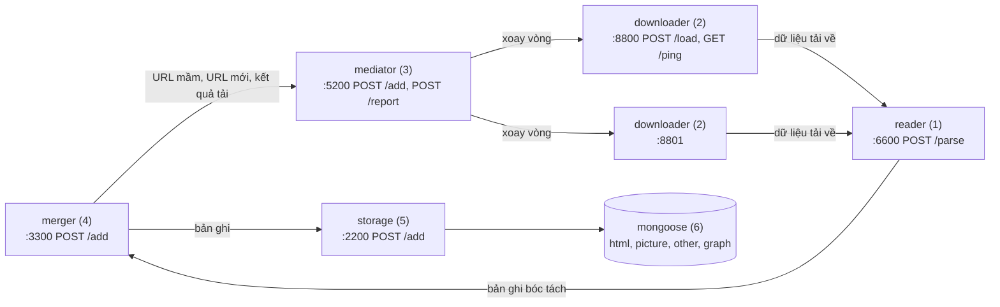

# Các khối dịch vụ (theo [slide của thầy](system-design.md))

Hệ thống thu thập gồm 5 khối dịch vụ nhỏ và MongoDB. Các khối giao tiếp bằng HTTP và JSON, mỗi khối chạy
trong một container riêng (cùng image `crawler:latest`) bằng lệnh `crawler serve <khối>`; app HTTP của mỗi khối
nằm ở `src/crawler/api/<khối>.py`.



| # | Khối | Cổng | Endpoint | Lệnh |
|---|---|---|---|---|
| 1 | reader | 6600 | `POST /parse` | `crawler serve reader` |
| 2 | downloader | 8800, 8801 | `POST /load`, `GET /ping` | `crawler serve downloader --port N` |
| 3 | mediator | 5200 | `POST /add`, `POST /report` | `crawler serve mediator` |
| 4 | merger | 3300 | `POST /add` | `crawler serve merger` |
| 5 | storage | 2200 | `POST /add` | `crawler serve storage` |
| 6 | mongoose | 27017 | | |

`POST /report` của mediator là endpoint thêm của nhóm (merger báo kết quả mỗi lần tải để chỉnh lịch crawl lại).
Phục vụ demo còn có thêm cờ `force` của mediator `POST /add` (URL đã biết cũng được xếp tải lại ngay, bỏ
`etag`/`last_modified`) và các endpoint `/crawl` của merger bên dưới. Ngoài những thứ này không có endpoint nào
khác slide. Body sai định dạng luôn trả `400 {"error": "<lý do>"}`.

### merger: `/crawl` (demo)

| Endpoint | Body | Trả về |
|---|---|---|
| `POST /crawl` | `{"url": "...", "max_pages": 30}`; `max_pages` là số nguyên ≥ 1, `null` hoặc bỏ trống = không giới hạn | trạng thái job |
| `GET /crawl/<job>` | | trạng thái job, `404` nếu không có |
| `POST /crawl/<job>/stop` | | trạng thái job, `404` nếu không có |

Trạng thái: `{"job", "url", "host", "max_pages", "queued", "saved", "urls", "stopped", "done"}`; `urls` là tối đa
50 URL vừa lưu, mới nhất trước. Job lan theo luật lọc link hiện tại nhưng chỉ trong host của `url`, không thêm host
đó vào phạm vi lan của merger. Job nằm trong bộ nhớ, merger khởi động lại thì mất. `done` khi đã dừng, khi mọi URL
đã xếp đều có bản ghi, hoặc sau 60 giây không có bản ghi mới (tải lỗi thì không có bản ghi trả về).

## Giao diện

### mediator: `POST :5200/add`, `POST :5200/report`

```json
{"urls": ["https://hust.edu.vn/tin-tuc1", "https://hust.edu.vn/tin-tuc2"]}
```

Trả ngay `200 {"accepted": 2, "duplicates": 0, "rejected": 0}`. URL đã có trong hàng đợi là `duplicates`
và giữ nguyên lịch; URL không hợp lệ là `rejected`.

`/report` nhận kết quả các lần tải từ merger:

```json
{"reports": [{"url": "https://hust.edu.vn/tin-tuc1", "change": "unchanged",
              "etag": "\"5f2a\"", "last_modified": "Fri, 23 Oct 2026 08:00:00 GMT"}]}
```

`change` là `new`, `modified`, `unchanged` hoặc `not_modified`; `etag`, `last_modified` là chuỗi hoặc `null`.
`url` là URL mediator đã giao (trước chuyển hướng). Trả `200 {"updated": N}`: số URL có trong hàng đợi đã được
đặt lại lịch; URL không có trong hàng đợi bị bỏ qua.

### downloader: `POST /load`, `GET /ping`

- `POST /load {"url": "...", "etag": "...", "last_modified": "..."}` → `202 {"status": "đã nhận"}`; đang bận →
  `409 {"status": "đang bận"}`. `etag` và `last_modified` tuỳ chọn: mediator gửi kèm khi lần tải trước có.
- `GET /ping` → `{"status": "đang chờ"}` hoặc `{"status": "đang bận"}`.

Mỗi node tải một URL một lúc: trang HTML bằng aiohttp, trang chỉ có khung JS thì mở lại bằng Playwright
(Chromium headless, thay cho Puppeteer), tài liệu thì tải nguyên tệp. Có `etag`/`last_modified` thì gửi
`If-None-Match`/`If-Modified-Since`; site trả `304` thì không tải nội dung, chỉ báo `not_modified` sang reader.
Mọi bước redirect đều phải là địa chỉ công khai. Trang bị chặn (đăng nhập, CAPTCHA, soft 404) và lỗi HTTP chỉ
được ghi log.

### reader: `POST :6600/parse`

Body là byte thô đã tải. Header:

| Header | Ý nghĩa |
|---|---|
| `X-Url` | URL cuối (sau redirect) |
| `X-Format` | `html`, `other`, hoặc `not_modified` (site trả `304`, body rỗng) |
| `Content-Type` | của response gốc |
| `X-Requested-Url` | URL mediator đã giao (tuỳ chọn; mặc định là `X-Url`) |
| `X-Etag`, `X-Last-Modified` | `ETag`, `Last-Modified` của response (tuỳ chọn) |

Trả `202`, bóc tách ở nền rồi gửi bản ghi sang merger. `not_modified` không được bóc tách, chỉ chuyển tiếp
`{"url", "requested_url", "format": "not_modified"}`. Body tối đa khoảng 101 MiB.

### merger và storage: `POST /add`

```json
{
  "url": "https://hust.edu.vn/tin-tuc1",
  "format": "html",
  "title": "Tin tức 1",
  "content": "Nội dung tin tức bóc tách được",
  "out-links": [["https://hust.edu.vn/tin-tuc2", "Tin tức 2"]]
}
```

- 5 trường trên là bắt buộc. `out-links` là danh sách cặp `[url đi ra, văn bản liên kết]`: chỉ liên kết (thẻ
  `a`, `area`, `link rel=next`), không gồm ảnh; văn bản là câu hoàn chỉnh chứa thẻ `a` (slide: "câu hoàn thiện chứa
  thẻ a"), hoặc chữ của thẻ khi nó đứng riêng như mục menu, số trang. storage ghi nó vào `graph.intro`.
- `format`: `html`, hoặc đuôi tài liệu (`pdf`, `docx`, ...) cho loại "other".
- Trường thêm, tuỳ chọn: `published_at`, `modified_at`, `author`, `language`, `headings`, `content_blocks`,
  `images`, `content_id`, `duplicate_of`. Trường lạ bị bỏ qua. `intro` không gửi: storage tự tính.
- reader gửi merger thêm `fingerprint` (dấu vân tay nội dung), `requested_url`, `etag`, `last_modified`.
- merger gửi storage thêm `change` (`new` hoặc `modified`). Với `unchanged`/`not_modified` merger chỉ gửi
  `{"url", "change"}` và storage chỉ cập nhật `checked_at` của bản ghi.
- Trả `200 {"status": "ok"}`. storage trả `503` khi Mongo không kết nối được, `422` khi Mongo từ chối bản ghi.

## Luồng dữ liệu

1. merger khởi động, nạp **tập url mầm** từ `seeds_file` (mặc định `config/domains/active.txt`): mỗi dòng một
   host (bắt đầu từ trang chủ) hoặc một URL (bắt đầu từ chính nó), rồi gửi sang mediator. Host của các mầm là
   **phạm vi lan**: link chỉ được theo trong đúng các host đó.
2. mediator giữ hàng đợi SQLite. Mỗi bước: lấy URL đến hạn của một host còn được gửi, chọn node downloader tiếp
   theo đang `"đang chờ"` (xoay vòng), gửi `/load` (kèm `etag`/`last_modified` nếu có). Một host có tối đa
   `per_host_concurrency` URL đang tải, và hai lần gửi cách nhau một khoảng chờ: tối thiểu `host_delay_seconds`,
   tự giãn (AutoThrottle, tới 5 giây) khi host trả lời chậm. Độ chậm đo bằng thời gian từ lúc node nhận `/load`
   tới lúc `/ping` trả lại `"đang chờ"`. Node trả `409` thì URL được gửi node kế. Gửi được thì hẹn lại theo mức
   gốc của loại URL: `hub` (trang chủ, trang mục) 1 ngày, `page` 7 ngày, `document` 30 ngày (`recrawl_days`).
3. downloader gửi dữ liệu sang reader; reader gửi bản ghi sang merger.
4. merger so `fingerprint` với lần trước và xếp lần tải vào `new`, `modified`, `unchanged`, `not_modified`.
   - `new`, `modified`: gửi bản ghi sang storage (trang trùng nội dung với trang khác chỉ gửi bản ghi rút gọn có
     `duplicate_of`; link của trang trùng không được crawl tiếp, để phân trang bỏ qua `?page` không sinh trang vô
     hạn), lọc `out-links` trong các host mầm, bỏ bẫy URL và URL đã biết, gom URL mới (500 URL hoặc 1 giây) gửi
     sang mediator.
   - `unchanged`, `not_modified`: chỉ báo storage cập nhật `checked_at`, không lan link.
   - Mọi lần tải: gửi `/report` sang mediator. mediator đặt lại lịch: `hub` giữ 1 ngày; `page`, `document` nhân
     đôi khoảng cách khi không đổi (tối đa 90 ngày), chia đôi khi đổi (không dưới mức gốc). Chi tiết:
     [architecture.md](architecture.md#4-crawl-lại-theo-thay-đổi).
5. storage upsert `html`/`other` theo `url`, thay toàn bộ cạnh `graph` của trang đó, tính lại `html.intro` của
   trang và của các đích đã có, tạo bản ghi `picture` cho ảnh mới ([data-schema.md](data-schema.md)).

Gửi giữa các khối thử lại 3 lần (chờ 1, 2, 4 giây) khi lỗi kết nối hoặc `5xx`. Chặng merger → storage và
merger → mediator (`/add`, `/report`) còn có outbox (`data/state/outbox.jsonl`): request gửi không được nằm lại
đó và được gửi lại mỗi 30 giây, riêng cho từng đích (storage tắt không chặn URL gửi sang mediator). Request bị
khối kia từ chối hẳn (`4xx`, ví dụ tài liệu lớn hơn 16 MB Mongo không nhận, storage trả `422`) vào
`outbox.dead.jsonl` thay vì chặn hàng. Khi merger tắt, URL mới đang chờ gom lô được ghi vào outbox.

## Chạy

Trong `crawler/`:

```bash
docker compose up -d --build        # 5 khối + MongoDB
docker compose logs -f mediator     # theo dõi
curl -X POST localhost:5200/add -d '{"urls": ["https://ctsv.hust.edu.vn/"]}'
```

Compose project tên `services`; các service là `reader`, `downloader-1`, `downloader-2`, `mediator`, `merger`,
`storage` (cùng image `crawler:latest`, lệnh `crawler serve <khối>`) và `mongoose` (`mongo:8.0`). Thứ tự khởi
động đi ngược chiều dữ liệu (storage, merger, reader, downloader, rồi mediator), để không khối nào gửi sang một
khối chưa chạy; URL mầm của merger chờ trong outbox tới khi mediator lên.

**Dữ liệu dùng chung với một tiến trình.** Các container gắn `./config` (chỉ đọc), `./data/state` (hàng đợi,
URL đã biết, fingerprint, outbox; cho mediator và merger), `./data/enrichment/cache` (cache LlamaParse; cho
reader), và dùng volume Mongo `mongoose_data`, tên thật `data_pipeline_mongodb_data` (giữ từ trước khi đổi
tên). Container chạy với user của máy (`UID`/`GID`, mặc định 1000; bash không export hai biến này, nên nếu user
của bạn không phải 1000 thì chạy `export UID GID=$(id -g)` trước `docker compose up -d`). Vì vậy
`docker compose up` tiếp tục đúng chỗ `crawler crawl run` dừng và ngược lại. Trong lúc các dịch vụ chạy,
`crawl run` báo trạng thái đang được dùng và thoát (và ngược lại).

Không có Docker: chạy từng khối bằng `uv run crawler serve <khối>` trong `crawler/` (đường dẫn trong
`config/*.yaml` tính từ `crawler/`, nên vẫn dùng chung `data/state`) với biến môi trường trỏ tới khối kề bên
(mặc định là tên service trong compose):

| Khối | Biến môi trường |
|---|---|
| downloader | `READER_URL` (`http://reader:6600`) |
| reader | `MERGER_URL` (`http://merger:3300`) |
| merger | `STORAGE_URL` (`http://storage:2200`), `MEDIATOR_URL` (`http://mediator:5200`) |
| storage | `MONGODB_URI`, `MONGODB_DATABASE` (mặc định theo `config/pipeline.yaml`) |

Danh sách node downloader của mediator nằm trong `config/mediator.yaml`.

## Thay khối bằng khối của nhóm khác

Mỗi khối chỉ biết địa chỉ khối kề bên. Muốn dùng reader của nhóm N1 thì đặt
`READER_URL=http://<ip-nhóm-N1>:6600` cho các container downloader; muốn dùng node downloader của nhóm N5 thì thêm
địa chỉ đó vào `downloaders` của `config/mediator.yaml`. Khối của nhóm khác chỉ cần cài đúng endpoint và
định dạng ở trên; các trường thêm (`etag`, `X-Etag`, `fingerprint`, `change`, `/report`) là tuỳ chọn. Khối không
gửi chúng thì mọi lần tải được coi như trang mới hoặc đổi và lịch giữ mức gốc.

## Cấu hình

| Tệp | Khối | Nội dung chính |
|---|---|---|
| `config/mediator.yaml` | mediator | `downloaders`, `host_delay_seconds`, `per_host_concurrency`, `autothrottle*`, timeout, `node_cooldown_seconds`, `max_attempts`, `recrawl_days`, `database` |
| `config/downloader.yaml` | downloader | user agent, timeout, redirect, giới hạn kích thước, `retries`, `browser_pages` |
| `config/reader.yaml` | reader | `llamaparse` (bật OCR đám mây, khoá trong `.env`), `cache_dir`, `document_workers` |
| `config/merger.yaml` | merger | `seeds_file`, `initial_scope_file`, kích thước lô, chu kỳ outbox, `database`, `outbox` |

Các tệp này nằm trong `crawler/config/` và dùng chung với `crawler crawl run`.

Cấu hình sai thì khối báo lỗi rõ và không khởi động.
