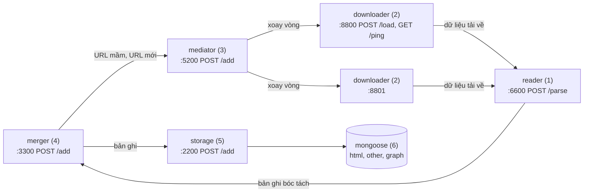

# Các khối dịch vụ (theo [slide của thầy](system-design.md))

Hệ thống thu thập gồm 5 khối dịch vụ nhỏ và MongoDB. Các khối giao tiếp bằng HTTP và JSON, mỗi khối chạy
trong một container riêng (cùng một image) bằng lệnh `services serve <khối>` (lõi nằm ở [`crawler/core/`](../core/README.md)).



| # | Khối | Cổng | Endpoint | Lệnh |
|---|---|---|---|---|
| 1 | reader | 6600 | `POST /parse` | `serve reader` |
| 2 | downloader | 8800, 8801 | `POST /load`, `GET /ping` | `serve downloader --port N` |
| 3 | mediator | 5200 | `POST /add` | `serve mediator` |
| 4 | merger | 3300 | `POST /add` | `serve merger` |
| 5 | storage | 2200 | `POST /add` | `serve storage` |
| 6 | mongoose | 27017 | | |

Không có endpoint nào khác. Body sai định dạng luôn trả `400 {"error": "<lý do>"}`.

## Giao diện

### mediator: `POST :5200/add`

```json
{"urls": ["https://hust.edu.vn/tin-tuc1", "https://hust.edu.vn/tin-tuc2"]}
```

Trả ngay `200 {"accepted": 2, "duplicates": 0, "rejected": 0}`. URL đã có trong hàng đợi là `duplicates`
và giữ nguyên lịch; URL không hợp lệ là `rejected`.

### downloader: `POST /load`, `GET /ping`

- `POST /load {"url": "..."}` → `202 {"status": "đã nhận"}`; đang bận → `409 {"status": "đang bận"}`.
- `GET /ping` → `{"status": "đang chờ"}` hoặc `{"status": "đang bận"}`.

Mỗi node tải một URL một lúc: trang HTML bằng aiohttp, trang chỉ có khung JS thì mở lại bằng Playwright
(Chromium headless, thay cho Puppeteer), tài liệu thì tải nguyên tệp. Mọi bước redirect đều phải là địa chỉ
công khai. Trang bị chặn (đăng nhập, CAPTCHA, soft 404) và lỗi HTTP chỉ được ghi log.

### reader: `POST :6600/parse`

Body là byte thô đã tải. Header: `X-Url` (URL cuối), `X-Format: html|other`, `Content-Type` (của response
gốc). Trả `202`, bóc tách ở nền rồi gửi bản ghi sang merger. Body tối đa khoảng 101 MiB.

### merger và storage: `POST /add`

```json
{
  "url": "https://hust.edu.vn/tin-tuc1",
  "format": "html",
  "title": "Tin tức 1",
  "content": "Nội dung tin tức bóc tách được",
  "out-links": [["https://hust.edu.vn/tin-tuc2", "Tin tức 2"]]
}
```

- 5 trường trên là bắt buộc. `out-links` là danh sách cặp `[url đi ra, văn bản liên kết]`: chỉ liên kết (thẻ
  `a`, `area`, `link rel=next`), không gồm ảnh; văn bản là câu hoàn chỉnh chứa thẻ `a` (slide: "câu hoàn thiện chứa
  thẻ a"), hoặc chữ của thẻ khi nó đứng riêng như mục menu, số trang.
- `format`: `html`, hoặc đuôi tài liệu (`pdf`, `docx`, ...) cho loại "other".
- Trường thêm, tuỳ chọn: `intro`, `published_at`, `modified_at`, `author`, `language`, `headings`,
  `content_blocks`, `images`, `content_id`, `duplicate_of`. Trường lạ bị bỏ qua.
- Trả `200 {"status": "ok"}`. storage trả `503` khi Mongo không kết nối được.

## Luồng dữ liệu

1. merger khởi động, nạp **tập url mầm** từ `seeds_file` (mặc định `config/domains/active.txt`): mỗi dòng một
   host (bắt đầu từ trang chủ) hoặc một URL (bắt đầu từ chính nó), rồi gửi sang mediator. Host của các mầm là
   **phạm vi lan**: link chỉ được theo trong đúng các host đó.
2. mediator giữ hàng đợi SQLite. Mỗi bước: lấy URL đến hạn của một host còn được gửi, chọn node downloader tiếp
   theo đang `"đang chờ"` (xoay vòng), gửi `/load`. Một host có tối đa `per_host_concurrency` URL đang tải, và
   hai lần gửi cách nhau một khoảng chờ: tối thiểu `host_delay_seconds`, tự giãn (AutoThrottle, tới 5 giây) khi
   host trả lời chậm. Độ chậm đo bằng thời gian từ lúc node nhận `/load` tới lúc `/ping` trả lại `"đang chờ"`,
   không cần endpoint nào thêm. Node trả `409` thì URL được gửi node kế. Gửi được thì đặt lịch crawl lại: trang
   chủ 1 ngày, trang 7 ngày, tài liệu 30 ngày (`recrawl_days`).
3. downloader gửi dữ liệu sang reader; reader gửi bản ghi sang merger.
4. merger gửi bản ghi sang storage (trang trùng nội dung với trang khác chỉ gửi bản ghi rút gọn có
   `duplicate_of`; link của trang trùng không được crawl tiếp, để phân trang bỏ qua `?page` không sinh trang vô
   hạn), lọc `out-links` trong các host mầm, bỏ bẫy URL và URL đã biết, gom URL mới (500 URL hoặc
   1 giây) gửi sang mediator.
5. storage upsert `html`/`other` theo `url` và thay toàn bộ cạnh `graph` của trang đó.

Gửi giữa các khối thử lại 3 lần (chờ 1, 2, 4 giây) khi lỗi kết nối hoặc `5xx`. Chặng merger → storage và
merger → mediator còn có outbox (`data/state/outbox.jsonl`): request gửi không được nằm lại đó và được gửi
lại mỗi 30 giây, riêng cho từng khối (storage tắt không chặn URL gửi sang mediator). Request bị khối kia từ
chối hẳn (`4xx`, ví dụ tài liệu lớn hơn 16 MB Mongo không nhận, storage trả `422`) vào `outbox.dead.jsonl`
thay vì chặn hàng. Khi merger tắt, URL mới đang chờ gom lô được ghi vào outbox.

## Chạy

```bash
cd services
docker compose up -d --build        # 5 khối + MongoDB
docker compose logs -f mediator   # theo dõi
curl -X POST localhost:5200/add -d '{"urls": ["https://ctsv.hust.edu.vn/"]}'
```

Thứ tự khởi động đi ngược chiều dữ liệu (storage, merger, reader, downloader, rồi mediator), để không
khối nào gửi sang một khối chưa chạy; URL mầm của merger chờ trong outbox tới khi mediator lên.

**Dữ liệu dùng chung với CLI.** Các container gắn `../core/data/state` (hàng đợi, URL đã biết, outbox) và
dùng volume Mongo `data_pipeline_mongodb_data` (giữ từ trước khi đổi tên, khai trong compose là `mongoose_data`), chạy với user của máy
(`UID`/`GID`, mặc định 1000; bash không export hai biến này, nên nếu user của bạn không phải 1000 thì chạy
`export UID GID=$(id -g)` trước `docker compose up -d`). Vì vậy `docker compose up` tiếp tục đúng chỗ `data-pipeline crawl run` dừng và
ngược lại. Trong lúc các dịch vụ chạy, `crawl run` báo trạng thái đang được dùng và thoát (và ngược lại).

Không có Docker: chạy từng khối bằng `uv run services serve <khối>` (trong `crawler/server/`; đường dẫn trong `config/*.yaml` tính từ `data_pipeline/`, nên vẫn dùng chung `data_pipeline/data/state`) với biến môi trường trỏ tới khối
kề bên (mặc định là tên service trong compose):

| Khối | Biến môi trường |
|---|---|
| downloader | `READER_URL` (`http://reader:6600`) |
| reader | `MERGER_URL` (`http://merger:3300`) |
| merger | `STORAGE_URL` (`http://storage:2200`), `MEDIATOR_URL` (`http://mediator:5200`) |
| storage | `MONGODB_URI`, `MONGODB_DATABASE` |

Danh sách node downloader của mediator nằm trong `config/mediator.yaml`.

## Thay khối bằng khối của nhóm khác

Mỗi khối chỉ biết địa chỉ khối kề bên. Muốn dùng reader của nhóm N1 thì đặt
`READER_URL=http://<ip-nhóm-N1>:6600` cho các container downloader; muốn dùng node downloader của nhóm N5 thì thêm
địa chỉ đó vào `downloaders` của `config/mediator.yaml`. Khối của nhóm khác chỉ cần cài đúng endpoint và
định dạng ở trên.

## Cấu hình

| Tệp | Khối | Nội dung chính |
|---|---|---|
| `config/mediator.yaml` | mediator | `downloaders`, `host_delay_seconds`, `per_host_concurrency`, `autothrottle*`, timeout, `node_cooldown_seconds`, `max_attempts`, `recrawl_days`, `database` |
| `config/downloader.yaml` | downloader | user agent, timeout, redirect, giới hạn kích thước, `retries`, `browser_pages` |
| `config/reader.yaml` | reader | `llamaparse` (bật OCR đám mây, khoá trong `.env`), `cache_dir`, `document_workers` |
| `config/merger.yaml` | merger | `seeds_file`, `initial_scope_file`, kích thước lô, chu kỳ outbox, `database`, `outbox` |

Các tệp này nằm trong `crawler/core/config/` và dùng chung với `data-pipeline crawl run`.

Cấu hình sai thì khối báo lỗi rõ và không khởi động.
