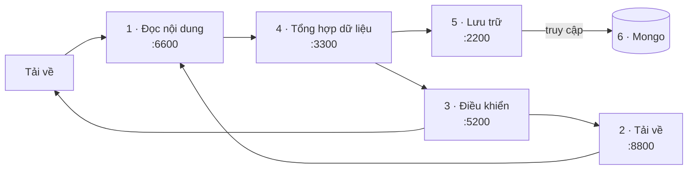

# Thiết kế hệ thống thu thập dựa trên kiến trúc dịch vụ nhỏ

Chép lại từ slide của thầy (13 trang). Nội dung và ví dụ JSON giữ nguyên như slide; cột "Tên mới" là tên các nhóm
thống nhất dùng sau này.

## Sơ đồ

Các mô-đun giao tiếp bằng http và sử dụng JSON.



| # | Mô-đun | Tên mới | Cổng | Nhóm |
|---|---|---|---|---|
| 1 | Đọc nội dung | reader | 6600 | N1 |
| 2 | Tải về | downloader | 8800 | N5 |
| 3 | Điều khiển | mediator | 5200 | BAT |
| 4 | Tổng hợp dữ liệu | merger | 3300 | N8 |
| 5 | Lưu trữ | storage | 2200 | N10 |
| 6 | Mongo | mongoose | | Ctrl + F |

## Luồng chạy

1. Khởi động: các mô-đun ở trạng thái chờ.
2. Tổng hợp dữ liệu nạp tập url mầm ban đầu.
3. Mô-đun điều khiển gửi url cần thu thập đến Tải về.
4. Tải về gửi dữ liệu tải được sang đọc nội dung.
5. Đọc nội dung gửi kết quả bóc tách sang tổng hợp dữ liệu.
6. Tổng hợp dữ liệu gửi các bản ghi sang lưu trữ.
7. Tổng hợp dữ liệu gửi các url mới sang điều khiển.

## Các mô-đun

### Đọc nội dung (reader)

*Đầu vào:*

- định dạng tài liệu: html, other
- nội dung: tài liệu
- uri: địa chỉ truy cập

*Đầu ra:*

- Đối với html: tiêu đề, nội dung văn bản, liên kết đi ra cùng với văn bản liên kết (câu hoàn thiện chứa thẻ a).
- Đối với other: Nội dung văn bản tách được.

⇒ gọi API đẩy kết quả sang mô-đun tổng hợp.

### Tải về (downloader)

*Đầu vào:*

- url: địa chỉ truy cập

*Xử lý:*

- Pupperteer + Chrome (headless) tải về nội dung đối với trang Web
- Tải tài liệu về đối với tài liệu

*Đầu ra:*

- Gửi đến Mô-đun đọc

### Điều khiển (mediator)

*Đầu vào:*

- gói url cần thu thập

*Xử lý:*

- Thiết lập thời gian chờ và lập lịch gửi đến các mô-đun tải về
- Cân bằng tải - lô-gic xoay vòng.

### Tổng hợp dữ liệu (merger)

*Đầu vào:*

- uri: địa chỉ truy cập
- định dạng: other
- các trường nội dung

*Xử lý:*

- Lọc url - lấy trong miền hust
- Loại url đã có

*Đầu ra:*

- Gửi đến lưu trữ
- Gửi url mới cho điều khiển

### Lưu trữ (storage) và Mongo (mongoose)

- Lưu trữ: Tiếp nhận dữ liệu và lưu vào Mongo theo đúng cấu trúc.
- Mongo: Dựng MongoDB.

## Đặc tả dịch vụ

### Tổng hợp dữ liệu (GIC: N8)

Giao diện thêm nội dung

```
post: http://ip:cổng/add
```

```
{"url": "https://hust.edu.vn/tin-tuc1",
"format": "html"
"title": "Tin tức 1",
"content": "Nội dung tin tức bóc tách được",
"out-links": ["url đi ra", "văn bản liên kết"]
}
```

### Lưu trữ (N10)

Giao diện thêm nội dung: *Thêm dữ liệu vào Mongo*

```
post: http://ip:cổng/add
```

```
{"url": "https://hust.edu.vn/tin-tuc1",
"format": "html"
"title": "Tin tức 1",
"content": "Nội dung tin tức bóc tách được",
"out-links": ["url đi ra", "văn bản liên kết"]
}
```

Danh sách trên slide:

| | |
|---|---|
| 2 | 20261093M Đinh Thuỳ Anh |
| 9 | 20261087M Phạm Duy Khánh |
| 11 | 20251230M Ngô Văn Tấn Lưu |
| 13 | 20252093M Nguyễn Nhật Minh |

### Mongo

```
{"html":
      [{"url": "https://hust.edu.vn/tin-tuc1",
        "format": "html"
        "title": "Tin tức 1",
        "content": "Nội dung tin tức bóc tách được",
        "intro": "Nội dung văn bản giới thiệu nếu có"}],
 "other":
    [{"url": "https://hust.edu.vn/tin-tuc1",
        "format": "docx",
        "url": "https://hust.edu.vn/tin-tuc1",
        "content": "html"
        }
     ],
  "graph": [{"src":  "https://hust.edu.vn/",
             "dest": "https://hust.edu.vn/tin-tuc1",
             "intro": "văn bản liên kết"]}],
}
```

### Điều khiển

Lệnh thêm url:

```
Post: http://ip:5200/add
```

```
{"urls": ["https://hust.edu.vn/tin-tuc1",
          "https://hust.edu.vn/tin-tuc2",
          "https://hust.edu.vn/tin-tuc3"]}
```

### Tải về

Lệnh tải url về:

```
Post http://ip:/load
```

```
{"url": "https://hust.edu.vn/tin-tuc"}
```

Lệnh kiểm tra trạng thái:

```
Get http://ip:/ping
```

```
{"status": "đang chờ"}
```

### Đọc nội dung

Lệnh đọc nội dung

```
post: http://ip:cổng/parse
```

http content - dữ liệu được tải về
