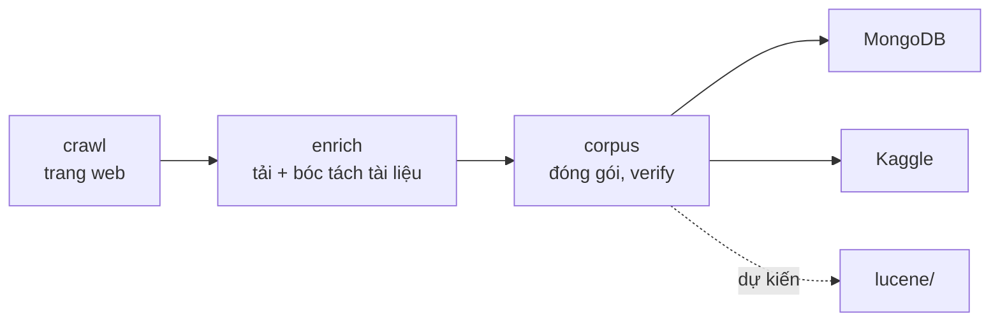

# Data pipeline

Thu thập, xử lý và chia sẻ corpus các trang web và tài liệu của Đại học Bách khoa Hà Nội (HUST).
Project này lo phần dữ liệu: crawl, tải và bóc tách tài liệu, đồ thị liên kết, MongoDB và Kaggle. Lập
chỉ mục và tìm kiếm nằm ở project [`lucene/`](../lucene/README.md); `lucene/` hiện chưa đọc corpus này, việc nối hai
project là dự kiến. Mọi lệnh chạy trong `data_pipeline/`.



## Cài đặt

Cần Python 3.13 và [uv](https://docs.astral.sh/uv/).

```bash
uv sync --extra enrich                 # crawler + bóc tách tài liệu (đủ cho mọi lệnh)
uv run playwright install chromium     # trình duyệt cho trang JavaScript
cp .env.example .env                   # rồi điền CRAWLER_CONTACT và các khoá API
```

Extra của dependency: không có (nền) cho người dùng corpus (`corpus pull|verify|import-mongo|query|prune-mongo`) và
`domains audit --no-browser`; `--extra crawl` cho crawler và trình duyệt của `domains audit`; `--extra enrich` thêm
bóc tách tài liệu (gồm cả `crawl`). Lệnh cần extra chưa cài sẽ báo cách cài. Nhóm `dev` (pytest, ruff, pyrefly, pre-commit) được `uv sync` cài mặc định.

## Bắt đầu nhanh

Một lệnh `data-pipeline` với các nhóm con; xem `uv run data-pipeline --help`.

```bash
# 1. Crawl (danh sách host trong config/domains/active.txt)
uv run data-pipeline crawl run -i config/domains/active.txt -o data/crawl
uv run data-pipeline crawl run -i config/domains/active.txt -o data/crawl --refresh   # cập nhật tăng dần

# 2. Tải và bóc tách tài liệu (đọc data/crawl/final, ghi data/enrichment)
uv run data-pipeline enrich run
uv run data-pipeline enrich status --json

# 3. Đóng gói corpus và kiểm tra
uv run data-pipeline corpus package --output data/corpus/latest
uv run data-pipeline corpus verify --corpus data/corpus/latest

# 4. Chia sẻ
docker compose up -d mongodb
uv run data-pipeline corpus import-mongo --corpus data/corpus/latest
uv run data-pipeline corpus publish --corpus data/corpus/latest   # lên Kaggle

# Máy mới: lấy bản đã công bố thay vì crawl lại
uv run data-pipeline corpus pull && uv run data-pipeline corpus import-mongo --corpus data/corpus/pulled
```

| Nhóm lệnh | Việc làm |
|---|---|
| `crawl run`, `crawl discover`, `crawl reextract` | crawl chính (resume, refresh), chẩn đoán sitemap, trích xuất lại từ HTML đã lưu |
| `enrich inventory\|download\|extract\|run\|status\|export\|reconcile-job` | tải và bóc tách tài liệu |
| `corpus build-graph\|package\|verify\|import-mongo\|query\|prune-mongo\|publish\|pull` | corpus, MongoDB, Kaggle |
| `domains audit` | kiểm tra host nào còn trả nội dung |
| `eval extraction` | chấm điểm thuật toán trích xuất nội dung |

### Lỗi và mã thoát chung

| Mã | Khi nào |
|---|---|
| 0 | thành công |
| 1 | hệ thống bên ngoài lỗi (MongoDB, Playwright, SQLite, `kaggle` CLI) hoặc một tiến trình con thất bại (kèm stderr của nó); in một dòng `Error: ...`, không in traceback |
| 2 | sai cách dùng: thiếu/sai tham số, file không tồn tại, cấu hình hay dữ liệu đầu vào không hợp lệ, thiếu extra; in `Error: ...` hoặc thông báo usage. |
| 130 | bị ngắt (Ctrl-C) |

Mã riêng của từng lệnh: `crawl run` 3/4 ([docs/crawl.md](docs/crawl.md#mã-thoát)); `corpus verify` 3 khi corpus không
hợp lệ; `enrich download|extract|run|status` 4 khi còn `pending`, `quota_blocked` hoặc `cloud_failed` lớn hơn 0.

## Cấu hình

| Vị trí | Nội dung |
|---|---|
| `.env` | `CRAWLER_CONTACT` (bắt buộc để crawl), `LLAMAPARSE_KEY1..n`, `KAGGLE_API_TOKEN`. Không commit |
| `config/crawler.yaml` | chính sách và hiệu năng crawler; kiểm tra chặt, phải đủ schema. Cờ CLI ghi đè khi chạy |
| `config/pipeline.yaml` | tải xuống, parser, MongoDB |
| `config/domains/` | `all.txt`, `active.txt`, `status.jsonl` (xem [docs/domains.md](docs/domains.md)) |
| `config/kaggle-dataset.json`, `config/corpus.lock.json` | metadata dataset Kaggle và bản đã ghim |
| `data/` | toàn bộ dữ liệu sinh ra (không đưa vào git), xem [Dữ liệu đầu ra](#dữ-liệu-đầu-ra) |

Biến môi trường đã export trong shell luôn thắng giá trị trong `.env`. Đường dẫn mặc định tính theo thư mục
project, không phụ thuộc thư mục bạn đang đứng; đường dẫn bạn gõ là tương đối theo thư mục hiện tại.

## Dữ liệu đầu ra

| Thư mục | Giai đoạn | Nội dung chính |
|---|---|---|
| `data/crawl/` | crawl | `articles.jsonl` thô, `state/` để resume, `html/` cho `crawl reextract`; `final/articles.jsonl` là bản chốt cho bước sau ([docs/crawl.md](docs/crawl.md#đầu-ra-datacrawl)) |
| `data/enrichment/` | enrich | tài liệu gốc trong `files/`, văn bản đã bóc tách trong `state.sqlite3` ([docs/enrich.md](docs/enrich.md#đầu-ra-dataenrichment)) |
| `data/corpus/<phiên bản>/` | corpus | gói hoàn chỉnh: `articles.jsonl`, `documents.jsonl`, `images.jsonl`, `links.jsonl` ([docs/data-schema.md](docs/data-schema.md#corpus-datacorpusphiên-bản)) |

Muốn dùng dữ liệu thì đọc `data/corpus/latest/` (hoặc `data/corpus/pulled/` nếu tải từ Kaggle); `data/crawl/` và
`data/enrichment/` là thư mục làm việc của pipeline.

## Phát triển

```bash
uv sync                              # nhóm dev gồm cả extras crawl và enrich
uv run pytest -q                     # bỏ qua test hiệu năng (marker `performance`)
uv run ruff check . && uv run ruff format --check .
uv run pyrefly check                 # kiểm tra kiểu (preset strict)
uv run pre-commit install            # cài hook (chạy ruff, pyrefly khi commit; pytest khi push)
```

Hook `pre-commit` nằm ở thư mục gốc repo và bỏ qua `lucene/` cùng `data_pipeline/data/`; ruff, pyrefly, uv-lock và pytest chỉ chạy cho thay đổi trong `data_pipeline/`. Package tổ chức theo
clean architecture (`domain`/`application`/`infrastructure` chia theo nghiệp vụ, cửa vào `cli/`; adapter được dựng ở
`bootstrap.py`; trạng thái crawl và enrich là một unit of work gồm các repository nhỏ,
xem [docs/architecture.md](docs/architecture.md#0-cấu-trúc-package)); quy tắc phụ thuộc được kiểm tra tự động
(`tests/unit/test_architecture.py`).

## Tài liệu

| Tài liệu | Nội dung |
|---|---|
| [docs/architecture.md](docs/architecture.md) | cấu trúc package, sơ đồ luồng crawl và luồng xử lý dữ liệu |
| [docs/crawl.md](docs/crawl.md) | seed, phạm vi, chính sách, frontier, resume, refresh, reextract, mã thoát, trích xuất HTML |
| [docs/enrich.md](docs/enrich.md) | tải, bóc tách tài liệu, cập nhật sau refresh |
| [docs/corpus.md](docs/corpus.md) | đóng gói, MongoDB, Kaggle |
| [docs/domains.md](docs/domains.md) | danh sách host và kiểm tra host |
| [docs/data-schema.md](docs/data-schema.md) | schema mọi file đầu ra |
