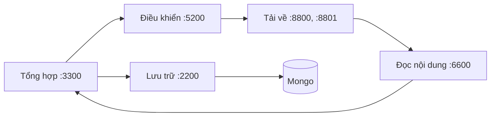

# Data pipeline

Hệ thống thu thập trang web và tài liệu của Đại học Bách khoa Hà Nội (HUST), gồm năm khối theo
slide của thầy: **Điều khiển, Tải về, Đọc nội dung, Tổng hợp dữ liệu, Lưu trữ** và **Mongo**. Folder này chứa lõi
của năm khối và CLI của nhóm; cùng lõi đó chạy thành năm dịch vụ HTTP/JSON theo slide ở
[`dich_vu/`](../dich_vu/README.md). Lập chỉ mục và tìm kiếm nằm ở project [`lucene/`](../lucene/README.md) (chưa đọc dữ liệu này).
Mọi lệnh chạy trong `data_pipeline/`.



Giao diện từng khối, luồng dữ liệu và cách thay khối bằng khối của nhóm khác: [dich_vu/README.md](../dich_vu/README.md).

## Chạy bằng Docker

Năm dịch vụ chạy từ [`dich_vu/`](../dich_vu/README.md) (`cd ../dich_vu && docker compose up -d --build`).

## Cài đặt để phát triển

Cần Python 3.13 và [uv](https://docs.astral.sh/uv/).

```bash
uv sync                                # gồm cả nhóm dev (pytest, ruff, pyrefly, pre-commit)
uv run playwright install chromium     # trình duyệt cho trang JavaScript
```

## Lệnh

| Lệnh | Việc làm |
|---|---|
| `reextract` | chạy lại bộ trích xuất trên HTML của bản crawl cũ, gửi kết quả vào Tổng hợp |
| `corpus package\|verify\|query\|publish\|pull` | đóng gói MongoDB thành corpus, truy vấn đồ thị, Kaggle ([docs/corpus.md](docs/corpus.md)) |
| `domains audit` | kiểm tra host nào còn trả nội dung ([docs/domains.md](docs/domains.md)) |
| `eval extraction` | chấm điểm thuật toán trích xuất nội dung |

| Mã thoát | Khi nào |
|---|---|
| 0 | thành công |
| 1 | hệ thống bên ngoài lỗi (MongoDB, Playwright, SQLite, `kaggle` CLI) hoặc tiến trình con thất bại; in một dòng `Error: ...` |
| 2 | sai cách dùng: thiếu/sai tham số, file không tồn tại, cấu hình không hợp lệ |
| 3 | `corpus verify`: corpus không hợp lệ |
| 130 | bị ngắt (Ctrl-C) |

## Cấu hình

| Vị trí | Nội dung |
|---|---|
| `.env` | `LLAMAPARSE_KEY1..n`, `KAGGLE_API_TOKEN`. Không commit |
| `config/controller.yaml`, `fetcher.yaml`, `parser.yaml`, `aggregator.yaml` | cấu hình từng khối ([dich_vu/README.md](../dich_vu/README.md#cấu-hình)) |
| `config/pipeline.yaml` | MongoDB cho các lệnh `corpus` |
| `config/domains/` | `all.txt`, `active.txt`, `status.jsonl` |
| `config/kaggle-dataset.json`, `config/corpus.lock.json` | metadata dataset Kaggle và bản đã ghim |

Dữ liệu các khối lưu lại (Mongo, SQLite của Điều khiển và Tổng hợp, gói corpus): [docs/data-schema.md](docs/data-schema.md).

## Phát triển

```bash
uv run pytest -q                     # bỏ qua test cần Docker (marker `docker`)
uv run pytest -q -m docker           # test với MongoDB thật (`docker compose -f ../dich_vu/compose.yaml up -d mongodb`)
uv run ruff check . && uv run ruff format --check .
uv run pyrefly check                 # kiểm tra kiểu (preset strict)
uv run pre-commit install            # cài hook (ruff, pyrefly khi commit; pytest khi push)
```

Package theo clean architecture, chia theo lớp rồi theo khối; các khối không import lẫn nhau và chỉ nói
chuyện qua HTTP. Quy tắc phụ thuộc được kiểm tra tự động (`tests/unit/test_architecture.py`), xem
[docs/architecture.md](docs/architecture.md).

## Tài liệu

| Tài liệu | Nội dung |
|---|---|
| [../dich_vu/README.md](../dich_vu/README.md) | các khối, endpoint, luồng dữ liệu, chạy, thay khối |
| [docs/architecture.md](docs/architecture.md) | cấu trúc package, quy tắc phụ thuộc, yêu cầu của thầy |
| [docs/data-schema.md](docs/data-schema.md) | MongoDB, trạng thái các khối, gói corpus |
| [docs/corpus.md](docs/corpus.md) | đóng gói, Kaggle |
| [docs/domains.md](docs/domains.md) | danh sách host và kiểm tra host |
