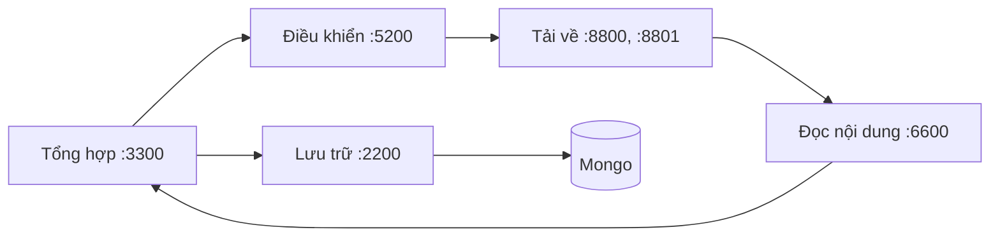

# Data pipeline

Hệ thống thu thập trang web và tài liệu của Đại học Bách khoa Hà Nội (HUST), gồm năm khối theo
slide của thầy: **Điều khiển, Tải về, Đọc nội dung, Tổng hợp dữ liệu, Lưu trữ** và **Mongo**. Folder này chứa lõi
của năm khối và CLI của nhóm; cùng lõi đó chạy thành năm dịch vụ HTTP/JSON theo slide ở
[`dich_vu/`](../dich_vu/README.md). Lập chỉ mục và tìm kiếm nằm ở project [`lucene/`](../lucene/README.md) (chưa đọc dữ liệu này).
Mọi lệnh chạy trong `data_pipeline/`.



Giao diện từng khối, luồng dữ liệu và cách thay khối bằng khối của nhóm khác: [dich_vu/README.md](../dich_vu/README.md).

## Hai cách chạy, một bộ dữ liệu

| Cách chạy | Lệnh | Khi nào dùng |
|---|---|---|
| **CLI một khối** | `uv run data-pipeline crawl run` (folder này) | crawl thật: năm khối gọi hàm trực tiếp trong một tiến trình, không tốn HTTP nội bộ, 64 URL tải song song |
| **Năm dịch vụ theo slide** | `docker compose up -d --build` trong [`dich_vu/`](../dich_vu/README.md) | nộp bài, ghép với khối của nhóm khác qua HTTP |

Hai cách chạy dùng chung **một code** (lõi trong `src/data_pipeline/`) và **một bộ dữ liệu**:

| Dữ liệu | Ở đâu |
|---|---|
| Hàng đợi và lịch crawl lại (Điều khiển) | `data/state/controller.sqlite3` |
| URL đã biết, chủ nội dung, host được phép lan (Tổng hợp) | `data/state/aggregator.sqlite3`, `data/state/outbox.jsonl` |
| Bài viết, tài liệu, đồ thị liên kết | MongoDB (`html`, `other`, `graph`), volume `data_pipeline_mongodb_data` |
| Cache LlamaParse | `data/enrichment/cache/` |
| Bản crawl Scrapy cũ (chỉ đọc, cho `reextract`) | `data/crawl/` |

Chạy bằng cách nào cũng **tiếp tục** đúng chỗ cách kia dừng: trang đã có không tải lại, chỉ đến lịch kiểm tra
định kỳ. Mỗi lúc chỉ một cách chạy được ghi vào trạng thái: mỗi file SQLite có một khoá; cách thứ hai báo
`Error: ... is in use by <ai đang chạy>` và thoát mã 2.

## Crawl bằng CLI

```bash
uv sync && uv run playwright install chromium
docker compose -f ../dich_vu/compose.yaml up -d mongodb    # chỉ Mongo
uv run data-pipeline crawl run                            # chạy tới khi hết URL đến hạn
uv run data-pipeline crawl run --forever                  # chạy mãi như dịch vụ (cả crawl lại định kỳ)
uv run data-pipeline crawl run --seeds my-seeds.txt       # mầm khác file mặc định
uv run data-pipeline seeds add soict.hust.edu.vn https://ctsv.hust.edu.vn/tin-tuc/abc
```

**Mầm** (`seeds_file` trong `config/aggregator.yaml`, mặc định `config/domains/active.txt`): mỗi dòng một mục,
bỏ dòng trống và `#`.

- Một **host** (`soict.hust.edu.vn`): bắt đầu từ `https://soict.hust.edu.vn/`.
- Một **URL** (`https://ctsv.hust.edu.vn/tin-tuc/abc`): bắt đầu từ chính URL đó (như slide).
- Từ mầm, hệ thống **lan ra nhưng chỉ trong host của mầm**: `soict.hust.edu.vn` không gồm `hust.edu.vn` hay
  `www.soict.hust.edu.vn`. Các host đã từng là mầm được nhớ trong trạng thái, nên lần chạy sau vẫn lan đúng.
- Mầm đã biết giữ nguyên lịch (không tải lại). Dòng sai bị bỏ qua kèm cảnh báo có số dòng.

**Nhịp tải** (`config/crawl.yaml`, ghi đè `config/controller.yaml`): 64 URL song song, tối đa 4 URL một host,
AutoThrottle (khoảng chờ một host bắt đầu 0,25 s, giãn tới 5 s khi host trả lời chậm), như pipeline Scrapy cũ.
Tải lỗi thử lại 3 lần (chờ 2, 4, 8 s). Ctrl+C dừng sạch: URL đang tải quay lại hàng đợi, URL mới chưa xếp hàng
vào outbox.

## Cài đặt để phát triển

Cần Python 3.13 và [uv](https://docs.astral.sh/uv/).

```bash
uv sync                                # gồm cả nhóm dev (pytest, ruff, pyrefly, pre-commit)
uv run playwright install chromium     # trình duyệt cho trang JavaScript
```

## Lệnh

| Lệnh | Việc làm |
|---|---|
| `crawl run [--seeds FILE] [--forever]` | crawl bằng năm khối trong một tiến trình |
| `seeds add HOST_HOẶC_URL...` | thêm mầm (host vào phạm vi, URL vào hàng đợi) mà không crawl |
| `reextract` | chạy lại bộ trích xuất trên HTML của bản crawl cũ, gửi kết quả vào Tổng hợp |
| `corpus package\|verify\|query\|publish\|pull` | đóng gói MongoDB thành corpus, truy vấn đồ thị, Kaggle ([docs/corpus.md](docs/corpus.md)) |
| `domains audit` | kiểm tra host nào còn trả nội dung ([docs/domains.md](docs/domains.md)) |
| `eval extraction` | chấm điểm thuật toán trích xuất nội dung |

| Mã thoát | Khi nào |
|---|---|
| 0 | thành công |
| 1 | hệ thống bên ngoài lỗi (MongoDB, Playwright, SQLite, `kaggle` CLI) hoặc tiến trình con thất bại; in một dòng `Error: ...` |
| 2 | sai cách dùng: thiếu/sai tham số, file không tồn tại, cấu hình không hợp lệ |
| 3 | `corpus verify`: corpus không hợp lệ |
| 130 | bị ngắt (Ctrl-C) |

## Cấu hình

| Vị trí | Nội dung |
|---|---|
| `.env` | `LLAMAPARSE_KEY1..n`, `KAGGLE_API_TOKEN`. Không commit |
| `config/controller.yaml`, `fetcher.yaml`, `parser.yaml`, `aggregator.yaml` | cấu hình từng khối, dùng cho cả hai cách chạy ([dich_vu/README.md](../dich_vu/README.md#cấu-hình)) |
| `config/crawl.yaml` | nhịp của `crawl run` (ghi đè `controller.yaml`) |
| `config/pipeline.yaml` | MongoDB cho các lệnh `corpus` |
| `config/domains/` | `all.txt`, `active.txt`, `status.jsonl` |
| `config/kaggle-dataset.json`, `config/corpus.lock.json` | metadata dataset Kaggle và bản đã ghim |

Dữ liệu các khối lưu lại (Mongo, SQLite của Điều khiển và Tổng hợp, gói corpus): [docs/data-schema.md](docs/data-schema.md).

## Phát triển

```bash
uv run pytest -q                     # bỏ qua test cần Docker (marker `docker`)
uv run pytest -q -m docker           # test với MongoDB thật (`docker compose -f ../dich_vu/compose.yaml up -d mongodb`)
uv run ruff check . && uv run ruff format --check .
uv run pyrefly check                 # kiểm tra kiểu (preset strict)
uv run pre-commit install            # cài hook (ruff, pyrefly khi commit; pytest khi push)
```

Package theo clean architecture, chia theo lớp rồi theo khối; các khối không import lẫn nhau. Chỉ
`runner/` (cho `crawl run`) nối các khối bằng lời gọi hàm; `dich_vu/` nối chúng qua HTTP. Quy tắc phụ thuộc được
kiểm tra tự động (`tests/unit/test_architecture.py`), xem [docs/architecture.md](docs/architecture.md).

## Tài liệu

| Tài liệu | Nội dung |
|---|---|
| [../dich_vu/README.md](../dich_vu/README.md) | các khối, endpoint, luồng dữ liệu, chạy, thay khối |
| [docs/architecture.md](docs/architecture.md) | cấu trúc package, quy tắc phụ thuộc, yêu cầu của thầy |
| [docs/data-schema.md](docs/data-schema.md) | MongoDB, trạng thái các khối, gói corpus |
| [docs/corpus.md](docs/corpus.md) | đóng gói, Kaggle |
| [docs/domains.md](docs/domains.md) | danh sách host và kiểm tra host |
