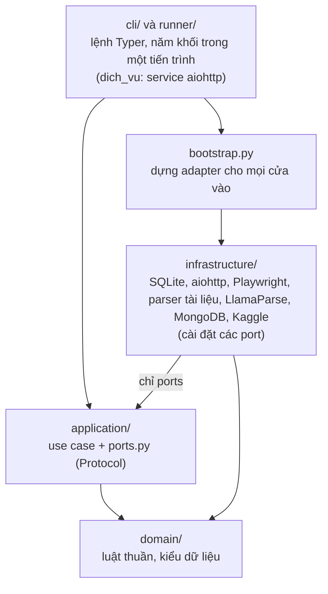
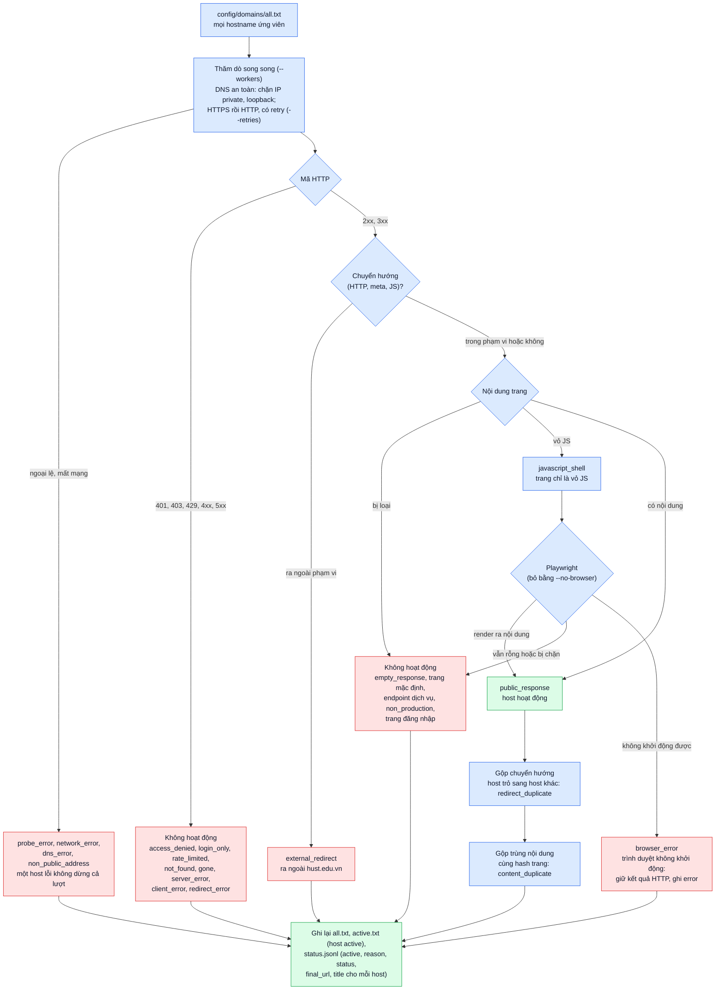
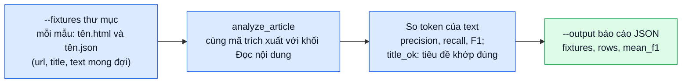

# Kiến trúc

## 1. Các khối dịch vụ

`data_pipeline` chứa năm khối trong slide của thầy (Điều khiển, Tải về, Đọc nội dung, Tổng hợp dữ liệu, Lưu
trữ, cùng Mongo) và hai cách chạy chúng trên cùng một code và cùng một bộ dữ liệu:

- **Một tiến trình** (`data-pipeline crawl run`, tầng `runner/` của package này): các khối gọi nhau bằng hàm.
- **Năm dịch vụ HTTP/JSON** (package `dich_vu` ở [`../../dich_vu/`](../../dich_vu/README.md)): đúng endpoint và
  cổng của slide. Giao diện, luồng dữ liệu và cách thay khối bằng khối của nhóm khác nằm ở README đó.

Hai cách chạy dùng chung use case và luật của từng khối; chỉ cách nối các khối khác nhau (lời gọi hàm hay
HTTP client), nên lọc link, lập lịch, AutoThrottle và schema Mongo luôn giống nhau.

## 2. Cấu trúc package

Một package `data_pipeline` (trong `src/`) với một lệnh `data-pipeline`, tổ chức theo clean architecture và
**chia theo lớp trước**: ở gốc có bốn lớp. Trong mỗi lớp, code chia theo nghiệp vụ: năm khối `controller`,
`fetcher`, `parser`, `aggregator`, `storage`, cùng `corpus` (đóng gói, Kaggle), `hosts` (`domains audit`) và
`shared` (phần dùng chung).



Quy tắc phụ thuộc (kiểm tra tự động bằng `tests/unit/test_architecture.py`):

1. **Lớp chỉ trỏ vào trong:** `domain` không import lớp nào khác; `application` chỉ dùng `domain`;
   `infrastructure` dùng `domain` và chỉ `application/<nghiệp vụ>/ports.py`. `cli/` và `runner/` gọi use case
   và `bootstrap.py`, không import `infrastructure`; `cli/` được khởi chạy `runner/` (lệnh `crawl run`). `domain` không
   import module I/O (`sqlite3`, `aiohttp`, `pymongo`, `playwright`, `llama_cloud`, `subprocess`, `os`, ...).
2. **Các khối không import lẫn nhau:** năm khối, `corpus` và `hosts` chỉ dùng phần của chính nó và `shared`.
   Chỉ `runner/` được dùng nhiều khối cùng lúc: nó cài port của khối này bằng use case của khối kia
   (`LocalNodes`, `DirectParserClient`, `DirectAggregatorClient`, `DirectServiceClient`). Trong `dich_vu`,
   `api/<khối>.py` chỉ dùng nghiệp vụ của khối đó (kiểm tra bằng `dich_vu/service_tests/test_architecture.py`).
3. Mọi module nằm trong `<lớp>/<nghiệp vụ>/`, `cli/`, `runner/` hoặc là `bootstrap.py`. Use case nhận adapter qua
   tham số; `bootstrap.py` là nơi duy nhất dựng adapter.

```text
src/data_pipeline/
  domain/
    shared/        url, links (normalize_url), assets (nhận diện tài liệu), protocol (chuỗi và bản ghi /add),
                   hostnames, refs, errors, config
    controller/    models, kinds, scheduling, rotation, throttle (giới hạn mỗi host, AutoThrottle)
    fetcher/       access (cổng đăng nhập/CAPTCHA/soft 404), formats, models
    parser/        extract/ (thuật toán tìm khối nội dung), records, models, merge, cache_key, cloud_pages, key_pool
    aggregator/    link_policy, links, seeds, batching, records, content, config
    storage/       documents
    corpus/        manifest, records, kaggle_metadata
    hosts/         classify, canonical, models
  application/<nghiệp vụ>/   use case + ports.py
  infrastructure/
    shared/        settings, env, network, files, http_client, sqlite, lease (một người ghi trạng thái)
    controller/    sqlite_queue, http_downloader, config_file
    fetcher/       http_getter, browser, playwright_driver, parser_client, config_file
    parser/        parsers/, llamaparse, cache, job_log, aggregator_client, raw_pages, config_file
    aggregator/    sqlite_state, outbox, service_client, config_file
    storage/       mongo
    corpus/        files/corpus_files, mongo, kaggle_cli
    hosts/         http_probe, browser_probe, report_files
  runner/          adapters (port bằng lời gọi hàm), crawl (vòng chạy của crawl run)
  cli/             main, crawl (crawl run, seeds add), reextract, corpus, domains, eval, context, errors
  bootstrap.py
```

| Nghiệp vụ | Port (trong `application/<nghiệp vụ>/ports.py`) | Adapter |
|---|---|---|
| `controller` | `UrlQueue`, `Downloader`, `Clock` | `SqliteUrlQueue`, `HttpDownloader` (dịch vụ), `LocalNodes` (một tiến trình) |
| `fetcher` | `PageGetter`, `Renderer`, `ParserClient` | `AiohttpPageGetter`, `PlaywrightRenderer`, `HttpParserClient` |
| `parser` | `LocalParser`, `CloudParser`, `ParseCache`, `CloudJobLog`, `AggregatorClient`, `RawPages` | `LocalParserAdapter`, `LlamaParseCloud`, `FileParseCache`, `LoggedCloudJobs`, `HttpAggregatorClient`, `SqliteRawPages` |
| `aggregator` | `SeenUrls`, `ContentOwners`, `ScopeHosts` (`AggregatorState`), `Outbox`, `ServiceClient` | `SqliteAggregatorState`, `JsonlOutbox`, `HttpServiceClient` (dịch vụ), `DirectServiceClient` (một tiến trình) |
| `storage` | `CorpusStore` | `MongoCorpusStore` |
| `corpus` | `CorpusFiles`, `CorpusDatabase`, `DatasetPublisher` | `LocalCorpusFiles`, `MongoCorpusDatabase`, `KaggleCli` |
| `hosts` | `HostProber`, `BrowserProber`, `AuditReports` | `HttpHostProber`, `PlaywrightBrowserProber`, `FileAuditReports` |

Test có cùng cấu trúc (`tests/unit/<lớp>/<nghiệp vụ>/`) và dùng bản giả trong `tests/fakes/`;
`tests/fakes/test_fakes_satisfy_ports.py` kiểm tra mỗi bản giả vẫn khớp port của nó.
`tests/integration/test_crawl_run.py` cho `crawl run` thu thập một website giả lập cục bộ
(`tests/integration/services/site.py`); `dich_vu/service_tests/integration/test_end_to_end.py` dựng năm dịch
vụ trên cổng ngẫu nhiên và thu thập cùng website đó. Cả hai so với cùng kết quả mong đợi (`EXPECTED_*` trong
`site.py`), nên hai cách chạy không thể lệch nhau.

## 3. Yêu cầu của thầy và nơi đáp ứng

| # | Yêu cầu | Nơi đáp ứng | Collection Mongo |
|---|---|---|---|
| Y1 | Thuật toán tìm khối nội dung | `domain/parser/extract/`, báo cáo `data-pipeline eval extraction` | |
| Y2 | Trang: tiêu đề, ngày đăng, tác giả, nội dung | khối Đọc nội dung, bản ghi `html` | `html` |
| Y3 | Tài liệu: nội dung văn bản | khối Đọc nội dung (parser cục bộ, LlamaParse) | `other` |
| Y4, Y6 | Đồ thị nguồn → đích kèm văn bản liên kết | `out-links` của bản ghi, khối Lưu trữ | `graph` |
| Y5 | Ảnh của trang | trường `images` của bản ghi `html` | `html` |
| Y7 | MongoDB theo lược đồ của slide | khối Lưu trữ, [data-schema.md](data-schema.md) | `html`, `other`, `graph` |
| Y8 | Chia sẻ dữ liệu của project | `corpus package/publish/pull`, `config/corpus.lock.json` ([corpus.md](corpus.md)) | |

## 4. Kiểm tra host (`domains audit`)

Chạy trước khi bật các khối để biết host nào còn trả nội dung công khai. Kết quả là `config/domains/active.txt`:
Tổng hợp dữ liệu lấy trang chủ của các host trong đó làm URL mầm (xem [domains.md](domains.md)). Tiến độ in ra stderr.



## 5. Chấm điểm trích xuất (`eval extraction`)

Đánh giá thuật toán tìm khối nội dung (Y1) trên các trang mẫu có đáp án, không cần mạng.


