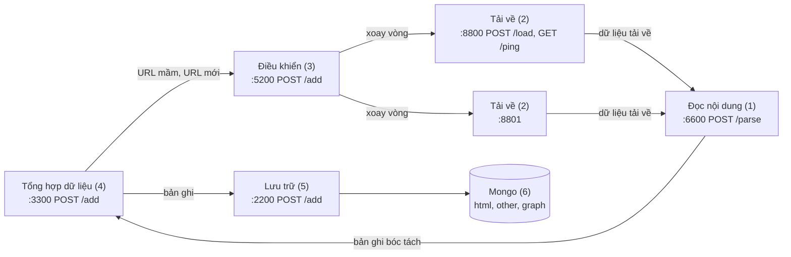

# Các khối dịch vụ (theo slide của thầy)

Hệ thống thu thập gồm 5 khối dịch vụ nhỏ và MongoDB. Các khối giao tiếp bằng HTTP và JSON, mỗi khối chạy
trong một container riêng (cùng một image) bằng lệnh `dich-vu serve <khối>` (lõi nằm ở [`data_pipeline/`](../data_pipeline/README.md)).



| # | Khối | Cổng | Endpoint | Lệnh |
|---|---|---|---|---|
| 1 | Đọc nội dung | 6600 | `POST /parse` | `serve parser` |
| 2 | Tải về | 8800, 8801 | `POST /load`, `GET /ping` | `serve fetcher --port N` |
| 3 | Điều khiển | 5200 | `POST /add` | `serve controller` |
| 4 | Tổng hợp dữ liệu | 3300 | `POST /add` | `serve aggregator` |
| 5 | Lưu trữ | 2200 | `POST /add` | `serve storage` |
| 6 | Mongo | 27017 | | |

Không có endpoint nào khác. Body sai định dạng luôn trả `400 {"error": "<lý do>"}`.

## Giao diện

### Điều khiển: `POST :5200/add`

```json
{"urls": ["https://hust.edu.vn/tin-tuc1", "https://hust.edu.vn/tin-tuc2"]}
```

Trả ngay `200 {"accepted": 2, "duplicates": 0, "rejected": 0}`. URL đã có trong hàng đợi là `duplicates`
và giữ nguyên lịch; URL không hợp lệ là `rejected`.

### Tải về: `POST /load`, `GET /ping`

- `POST /load {"url": "..."}` → `202 {"status": "đã nhận"}`; đang bận → `409 {"status": "đang bận"}`.
- `GET /ping` → `{"status": "đang chờ"}` hoặc `{"status": "đang bận"}`.

Mỗi node tải một URL một lúc: trang HTML bằng aiohttp, trang chỉ có khung JS thì mở lại bằng Playwright
(Chromium headless, thay cho Puppeteer), tài liệu thì tải nguyên tệp. Mọi bước redirect đều phải là địa chỉ
công khai. Trang bị chặn (đăng nhập, CAPTCHA, soft 404) và lỗi HTTP chỉ được ghi log.

### Đọc nội dung: `POST :6600/parse`

Body là byte thô đã tải. Header: `X-Url` (URL cuối), `X-Format: html|other`, `Content-Type` (của response
gốc). Trả `202`, bóc tách ở nền rồi gửi bản ghi sang Tổng hợp. Body tối đa khoảng 101 MiB.

### Tổng hợp và Lưu trữ: `POST /add`

```json
{
  "url": "https://hust.edu.vn/tin-tuc1",
  "format": "html",
  "title": "Tin tức 1",
  "content": "Nội dung tin tức bóc tách được",
  "out-links": [["https://hust.edu.vn/tin-tuc2", "Tin tức 2"]]
}
```

- 5 trường trên là bắt buộc. `out-links` là danh sách cặp `[url đi ra, văn bản liên kết]`.
- `format`: `html`, hoặc đuôi tài liệu (`pdf`, `docx`, ...) cho loại "other".
- Trường thêm, tuỳ chọn: `intro`, `published_at`, `modified_at`, `author`, `language`, `headings`,
  `content_blocks`, `images`, `content_id`, `duplicate_of`. Trường lạ bị bỏ qua.
- Trả `200 {"status": "ok"}`. Lưu trữ trả `503` khi Mongo không kết nối được.

## Luồng dữ liệu

1. Tổng hợp khởi động, nạp **tập url mầm** từ `seeds_file` (mặc định `config/domains/active.txt`): mỗi dòng một
   host (bắt đầu từ trang chủ) hoặc một URL (bắt đầu từ chính nó), rồi gửi sang Điều khiển. Host của các mầm là
   **phạm vi lan**: link chỉ được theo trong đúng các host đó.
2. Điều khiển giữ hàng đợi SQLite. Mỗi bước: lấy URL đến hạn của một host còn được gửi, chọn node Tải về tiếp
   theo đang `"đang chờ"` (xoay vòng), gửi `/load`. Một host có tối đa `per_host_concurrency` URL đang tải, và
   hai lần gửi cách nhau một khoảng chờ: tối thiểu `host_delay_seconds`, tự giãn (AutoThrottle, tới 5 giây) khi
   host trả lời chậm. Độ chậm đo bằng thời gian từ lúc node nhận `/load` tới lúc `/ping` trả lại `"đang chờ"`,
   không cần endpoint nào thêm. Node trả `409` thì URL được gửi node kế. Gửi được thì đặt lịch crawl lại: trang
   chủ 1 ngày, trang 7 ngày, tài liệu 30 ngày (`recrawl_days`).
3. Tải về gửi dữ liệu sang Đọc nội dung; Đọc nội dung gửi bản ghi sang Tổng hợp.
4. Tổng hợp gửi bản ghi sang Lưu trữ (trang trùng nội dung với trang khác chỉ gửi bản ghi rút gọn có
   `duplicate_of`), lọc `out-links` trong các host mầm, bỏ bẫy URL và URL đã biết, gom URL mới (500 URL hoặc
   1 giây) gửi sang Điều khiển.
5. Lưu trữ upsert `html`/`other` theo `url` và thay toàn bộ cạnh `graph` của trang đó.

Gửi giữa các khối thử lại 3 lần (chờ 1, 2, 4 giây) khi lỗi kết nối hoặc `5xx`. Chặng Tổng hợp → Lưu trữ và
Tổng hợp → Điều khiển còn có outbox (`data/state/outbox.jsonl`): request gửi không được nằm lại đó và được gửi
lại mỗi 30 giây, riêng cho từng khối (Lưu trữ tắt không chặn URL gửi sang Điều khiển). Request bị khối kia từ
chối hẳn (`4xx`, ví dụ tài liệu lớn hơn 16 MB Mongo không nhận, Lưu trữ trả `422`) vào `outbox.dead.jsonl`
thay vì chặn hàng. Khi Tổng hợp tắt, URL mới đang chờ gom lô được ghi vào outbox.

## Chạy

```bash
cd dich_vu
docker compose up -d --build        # 5 khối + MongoDB
docker compose logs -f controller   # theo dõi
curl -X POST localhost:5200/add -d '{"urls": ["https://ctsv.hust.edu.vn/"]}'
```

Thứ tự khởi động đi ngược chiều dữ liệu (Lưu trữ, Tổng hợp, Đọc nội dung, Tải về, rồi Điều khiển), để không
khối nào gửi sang một khối chưa chạy; URL mầm của Tổng hợp chờ trong outbox tới khi Điều khiển lên.

**Dữ liệu dùng chung với CLI.** Các container gắn `../data_pipeline/data/state` (hàng đợi, URL đã biết, outbox) và
dùng volume Mongo `data_pipeline_mongodb_data` (project compose vẫn tên `data_pipeline`), chạy với user của máy
(`UID`/`GID`, mặc định 1000; bash không export hai biến này, nên nếu user của bạn không phải 1000 thì chạy
`export UID GID=$(id -g)` trước `docker compose up -d`). Vì vậy `docker compose up` tiếp tục đúng chỗ `data-pipeline crawl run` dừng và
ngược lại. Trong lúc các dịch vụ chạy, `crawl run` báo trạng thái đang được dùng và thoát (và ngược lại).

Không có Docker: chạy từng khối bằng `uv run dich-vu serve <khối>` (trong `dich_vu/`; đường dẫn trong `config/*.yaml` tính từ `data_pipeline/`, nên vẫn dùng chung `data_pipeline/data/state`) với biến môi trường trỏ tới khối
kề bên (mặc định là tên service trong compose):

| Khối | Biến môi trường |
|---|---|
| Tải về | `PARSER_URL` (`http://parser:6600`) |
| Đọc nội dung | `AGGREGATOR_URL` (`http://aggregator:3300`) |
| Tổng hợp | `STORAGE_URL` (`http://storage:2200`), `CONTROLLER_URL` (`http://controller:5200`) |
| Lưu trữ | `MONGODB_URI`, `MONGODB_DATABASE` |

Danh sách node Tải về của Điều khiển nằm trong `config/controller.yaml`.

## Thay khối bằng khối của nhóm khác

Mỗi khối chỉ biết địa chỉ khối kề bên. Muốn dùng Đọc nội dung của nhóm N1 thì đặt
`PARSER_URL=http://<ip-nhóm-N1>:6600` cho các container Tải về; muốn dùng node Tải về của nhóm N5 thì thêm
địa chỉ đó vào `downloaders` của `config/controller.yaml`. Khối của nhóm khác chỉ cần cài đúng endpoint và
định dạng ở trên.

## Cấu hình

| Tệp | Khối | Nội dung chính |
|---|---|---|
| `config/controller.yaml` | Điều khiển | `downloaders`, `host_delay_seconds`, `per_host_concurrency`, `autothrottle*`, timeout, `node_cooldown_seconds`, `max_attempts`, `recrawl_days`, `database` |
| `config/fetcher.yaml` | Tải về | user agent, timeout, redirect, giới hạn kích thước, `retries`, `browser_pages` |
| `config/parser.yaml` | Đọc nội dung | `llamaparse` (bật OCR đám mây, khoá trong `.env`), `cache_dir`, `document_workers` |
| `config/aggregator.yaml` | Tổng hợp | `seeds_file`, `initial_scope_file`, kích thước lô, chu kỳ outbox, `database`, `outbox` |

Các tệp này nằm trong `data_pipeline/config/` và dùng chung với `data-pipeline crawl run`.

Cấu hình sai thì khối báo lỗi rõ và không khởi động.
