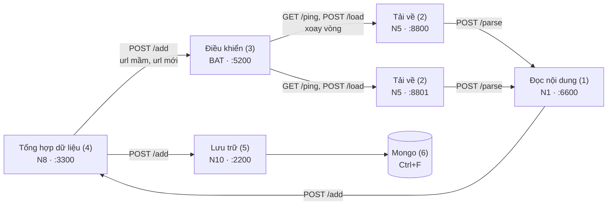

# Điều khiển (khối 3, cổng 5200)

Service **Điều khiển** dùng chung cho cả lớp, theo slide "Thiết kế hệ thống thu thập dựa trên kiến trúc dịch vụ
nhỏ" ([`docs/`](docs/)). Nhóm BAT phụ trách khối này. README dành cho các nhóm khác: mục 4 ghi việc **mỗi nhóm**
cần làm để nối với Điều khiển. Mô tả code để thuyết trình nằm ở [`docs/architecture.md`](docs/architecture.md).

## 1. Vị trí trong hệ thống

Các mô-đun giao tiếp bằng HTTP và JSON (slide 1):



| # | Khối | Nhóm | Cổng | Nói chuyện với Điều khiển? |
|---|---|---|---|---|
| 1 | Đọc nội dung | N1 | 6600 | Không |
| 2 | Tải về | N5 | 8800 | **Có**: Điều khiển gọi `/ping`, `/load` của node |
| 3 | Điều khiển | BAT | 5200 | |
| 4 | Tổng hợp dữ liệu | N8 | 3300 | **Có**: gọi `POST :5200/add` |
| 5 | Lưu trữ | N10 | 2200 | Không |
| 6 | Mongo | Ctrl+F | 27017 | Không |

Thứ tự trong slide:

1. Khởi động: các mô-đun ở trạng thái chờ.
2. Tổng hợp dữ liệu nạp tập url mầm ban đầu và gửi sang Điều khiển.
3. **Điều khiển gửi url cần thu thập đến Tải về.**
4. Tải về gửi dữ liệu tải được sang Đọc nội dung.
5. Đọc nội dung gửi kết quả bóc tách sang Tổng hợp dữ liệu.
6. Tổng hợp gửi bản ghi sang Lưu trữ, và gửi **url mới** sang Điều khiển (quay lại bước 3).

## 2. Điều khiển: đầu vào, xử lý, đầu ra

**Đầu vào:** gói url cần thu thập (`POST /add` từ Tổng hợp dữ liệu).

**Xử lý:**
- Chuẩn hoá và loại url trùng, rồi đưa vào hàng đợi (lưu trên đĩa, tắt đi bật lại vẫn còn).
- **Thiết lập thời gian chờ:** hai lần gửi vào cùng một host cách nhau ít nhất `host_delay_seconds` (mặc định
  1 giây), để không dồn tải lên một website của trường.
- **Lập lịch:** url gửi xong được hẹn kiểm tra lại định kỳ; url gửi lỗi được thử lại.
- **Cân bằng tải, lô-gic xoay vòng:** mỗi url giao cho node Tải về **kế tiếp** trong danh sách mà đang rảnh.
  Node chết thì tạm bỏ qua.

**Đầu ra:** từng url, gửi tới một node Tải về (`POST /load`).

**Tác dụng:** các website của trường không bị dồn tải; việc chia đều cho node của các nhóm; một node chết không
làm dừng hệ thống; trang đã thu thập tự được cập nhật định kỳ.

**Công nghệ:** Python 3.13, `aiohttp` (HTTP server và client, bất đồng bộ), SQLite (hàng đợi), Docker Compose
(đóng gói, demo). Chi tiết cách làm từng phần: [`docs/architecture.md`](docs/architecture.md).

Điều khiển **không** tải trang, **không** lọc theo miền hust (việc của Tổng hợp) và **không** nhận lại kết quả
tải (node Tải về gửi thẳng sang Đọc nội dung).

## 3. Đặc tả dịch vụ

Mỗi mục ghi rõ phần **theo slide** và phần **nhóm BAT bổ sung** (slide không nói tới, cần các nhóm thống nhất).

### 3.1. Điều khiển cung cấp: `POST http://<ip>:5200/add`

Theo slide:

```json
{"urls": ["https://hust.edu.vn/tin-tuc1",
          "https://hust.edu.vn/tin-tuc2",
          "https://hust.edu.vn/tin-tuc3"]}
```

Bổ sung: Điều khiển trả lời **ngay** (không chờ tải), mã `200`:

```json
{"accepted": 2, "duplicates": 1, "rejected": 0}
```

| Trường | Nghĩa |
|---|---|
| `accepted` | url mới, đã vào hàng đợi |
| `duplicates` | url đã có (hoặc lặp trong cùng gói): giữ nguyên lịch cũ, không tải thêm lần nữa |
| `rejected` | không phải địa chỉ web (`mailto:`, `ftp:`, có user:mật khẩu, sai cú pháp) |

Body không đúng dạng `{"urls": [chuỗi, ...]}` hoặc không phải JSON: mã `400`, `{"error": "<lý do>"}`.
Đây là endpoint **duy nhất** của Điều khiển.

### 3.2. Điều khiển gọi tới node Tải về: `GET /ping`, `POST /load`

| Lệnh | Theo slide | Bổ sung |
|---|---|---|
| `GET http://<node>/ping` | trả `{"status": "đang chờ"}` | trả `{"status": "đang bận"}` khi đang tải |
| `POST http://<node>/load` với `{"url": "https://..."}` | node nhận url để tải | trả mã `2xx` ngay khi nhận (vd. `202 {"status": "đã nhận"}`); trả `409` nếu đang bận |

## 4. Mỗi nhóm cần làm gì

### N8 · Tổng hợp dữ liệu: gửi url vào Điều khiển

- Khi khởi động: gửi tập url mầm, `POST http://<ip-BAT>:5200/add {"urls": [...]}`.
- Khi nhận bản ghi từ Đọc nội dung: lọc `out-links` (chỉ lấy miền hust, bỏ url đã có), rồi gửi các url **mới**
  vào cùng endpoint đó. Nên gom thành lô (vd. vài trăm url mỗi lần) thay vì gửi từng url.
- Không cần gửi lại url cũ để thu thập lại: Điều khiển tự hẹn lịch kiểm tra lại (mục 5).
- Gửi trùng cũng không sao: Điều khiển đếm vào `duplicates` và bỏ qua.
- Gửi lỗi (mất kết nối, `5xx`) thì nên thử lại; Điều khiển giữ hàng đợi trên đĩa nên khởi động lại không mất url.

Tự thử:

```bash
curl -X POST http://<ip-BAT>:5200/add -d '{"urls": ["https://hust.edu.vn/"]}'
# {"accepted": 1, "duplicates": 0, "rejected": 0}
```

### N5 · Tải về: để Điều khiển giao việc cho node

Node phải cài **đúng hai endpoint** ở 3.2 và tuân theo các quy tắc sau:

1. **`/ping` trả đúng chuỗi `"đang chờ"`** (có dấu, mã `200`, JSON) khi rảnh. Điều khiển chỉ giao việc cho node
   trả đúng chuỗi này. Chuỗi khác (`"idle"`, `"dang cho"`, ...) bị bỏ qua và ghi log `unexpected ping status`.
   Gõ dấu kiểu tổ hợp (NFD) vẫn được nhận.
2. **`/load` phải trả lời ngay, rồi mới tải ở nền.** Điều khiển chỉ chờ `/load` trong `load_timeout_seconds`
   (10 giây). Node tải xong rồi mới trả lời sẽ bị tính là lỗi khi trang lâu, và bị nghỉ 30 giây.
3. Đang tải thì `/ping` trả `"đang bận"`, và `/load` trả `409`. Gặp `409`, Điều khiển chuyển url sang node kế,
   node không bị phạt.
4. `/ping` không trả lời trong `ping_timeout_seconds` (2 giây), hoặc trả mã khác `2xx`: node bị coi là chết và
   bị nghỉ `node_cooldown_seconds` (30 giây). Url vẫn nằm trong hàng đợi, chờ node khác.
5. Tải xong thì **gửi thẳng sang Đọc nội dung** (`POST http://<ip-N1>:6600/parse`, slide: "http content - dữ
   liệu được tải về"). Không gửi gì về Điều khiển.

**Code mẫu:** [`demo/fake_fetcher.py`](demo/fake_fetcher.py) (khoảng 50 dòng) là một node Tải về giả lập trả lời
đúng giao thức trên, chỉ ghi log url nhận được. N5 có thể lấy làm khung rồi thêm phần tải và gửi sang N1.

**Tự kiểm tra node trước khi ghép:**

```bash
curl http://<node>/ping
# {"status": "đang chờ"}
curl -i -X POST http://<node>/load -d '{"url": "https://hust.edu.vn/"}'
# HTTP/1.1 202 ...   (trả ngay)
curl http://<node>/ping
# {"status": "đang bận"}   (trong lúc đang tải)
```

**Đăng ký node:** gửi địa chỉ `http://<ip>:<cổng>` của node cho nhóm BAT. Nhóm BAT thêm vào `downloaders` trong
`config/controller.yaml` và khởi động lại Điều khiển (`docker compose restart dieu-khien`; hàng đợi giữ nguyên).
Máy chạy Điều khiển phải gọi được tới IP đó (cùng mạng LAN, không bị tường lửa chặn).

### N1 · Đọc nội dung, N10 · Lưu trữ, Ctrl+F · Mongo

Không gọi Điều khiển và không bị Điều khiển gọi. Cần biết:

- Dữ liệu tới Đọc nội dung là do node **Tải về** gửi, không phải Điều khiển.
- Mỗi url được Điều khiển giao lại theo chu kỳ (mục 5), nên Đọc nội dung, Tổng hợp và Lưu trữ sẽ nhận **cùng một
  url nhiều lần**. Lưu trữ nên ghi đè theo `url` thay vì thêm bản mới.

## 5. Lập lịch

Điều khiển phân url thành ba loại, theo đường dẫn:

| Loại | Nhận biết | Kiểm tra lại sau |
|---|---|---|
| `hub` (trang chủ) | đường dẫn rỗng hoặc `/` | 1 ngày |
| `document` (tài liệu) | đuôi `.pdf`, `.doc(x)`, `.xls(x)`, `.ppt(x)`, `.odt`, `.rtf`, `.txt`, `.csv`, `.zip`, ... | 30 ngày |
| `page` (trang thường) | còn lại | 7 ngày |

- Giao thành công thì hẹn lại theo bảng (`recrawl_days`; đặt `0` thì không kiểm tra lại loại đó).
- Giao lỗi thì url vẫn đến hạn ngay, thử lại ở lượt sau. Lỗi `max_attempts` (5) lần liền thì lùi một chu kỳ.
- Hai lần giao vào cùng host cách nhau ít nhất `host_delay_seconds`. Trong lúc chờ, url của host khác vẫn được
  giao.

## 6. Chạy

**Docker** (nhóm BAT chạy cho cả lớp):

```bash
# Sửa danh sách node Tải về trong config/controller.yaml (downloaders), rồi:
docker compose up -d --build
curl -X POST localhost:5200/add -d '{"urls": ["https://hust.edu.vn/"]}'
docker compose logs -f dieu-khien
```

**Demo với hai node giả lập** (không cần nhóm khác):

```bash
DIEU_KHIEN_CONFIG=config/controller.demo.yaml docker compose --profile demo up -d --build
curl -X POST localhost:5200/add -d '{"urls": ["https://hust.edu.vn/", "https://soict.hust.edu.vn/"]}'
docker compose logs fake-fetcher-1 fake-fetcher-2   # mỗi node nhận một url, xoay vòng
docker compose --profile demo down
```

**Không có Docker** (trong thư mục `dieu_khien/`, mỗi lệnh một terminal):

```bash
uv sync
uv run python -m demo.fake_fetcher --port 8800
uv run python -m demo.fake_fetcher --port 8801
uv run dieu-khien serve --config config/controller.local.yaml   # hàng đợi ở data/controller.sqlite3
```

Log của Điều khiển ghi từng lần giao (`load <url> -> <node>: ok`), và mỗi 30 giây in tóm tắt
`controller: <n> urls, <n> due, <n>/<n> nodes resting`.

## 7. Cấu hình (`config/controller.yaml`)

| Khoá | Mặc định | Ý nghĩa |
|---|---|---|
| `port` | 5200 | cổng của `/add` |
| `downloaders` | (bắt buộc) | danh sách node Tải về, vd. `http://10.0.0.11:8800` |
| `host_delay_seconds` | 1.0 | thời gian chờ giữa hai lần giao vào cùng host |
| `ping_timeout_seconds` | 2 | thời gian chờ `/ping` |
| `load_timeout_seconds` | 10 | thời gian chờ `/load` |
| `node_cooldown_seconds` | 30 | thời gian nghỉ của node lỗi |
| `max_attempts` | 5 | số lần giao lỗi liền trước khi lùi url một chu kỳ |
| `tick_seconds` | 0.5 | nhịp kiểm tra khi không có việc |
| `recrawl_days` | `{hub: 1, page: 7, document: 30}` | chu kỳ kiểm tra lại (ngày) |
| `database` | (bắt buộc) | tệp SQLite của hàng đợi |

Ba tệp có sẵn: `controller.yaml` (chạy thật, Docker), `controller.demo.yaml` (hai node giả trong compose),
`controller.local.yaml` (không Docker). Cấu hình sai hoặc không ghi được `database` thì service in lý do và
thoát mã 2.

## 8. Phát triển

```bash
uv sync
uv run pytest -q
uv run ruff check . && uv run ruff format --check .
uv run pyrefly check
```

Cấu trúc code, luồng xử lý và thuật toán: [`docs/architecture.md`](docs/architecture.md).
