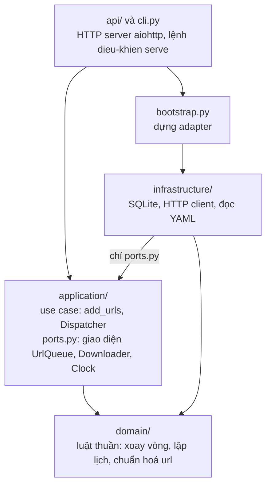
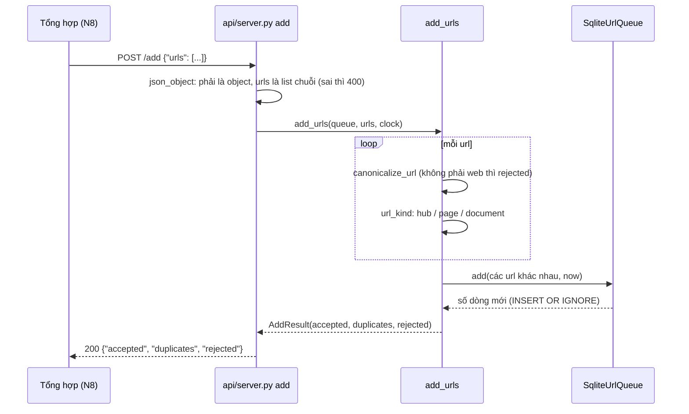
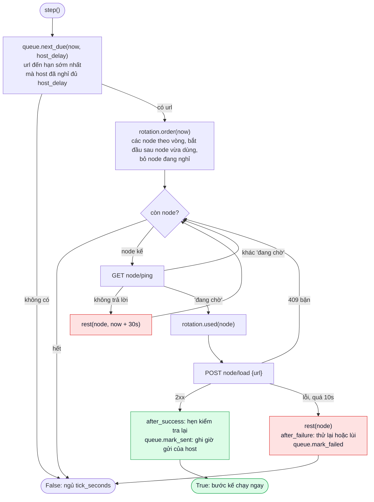

# Điều khiển: mô tả code

Tài liệu mô tả code của service Điều khiển (khối 3 trong slide). Với mỗi thành phần, tài liệu ghi: **làm gì**,
**tác dụng**, **cách làm** và **công nghệ**. Giao diện cho các nhóm khác nằm ở [README](../README.md).

Toàn bộ service gồm khoảng 800 dòng Python trong `src/dieu_khien/`.

## 1. Yêu cầu của slide và nơi đáp ứng

| Slide (khối Điều khiển) | Thành phần | Code |
|---|---|---|
| Đầu vào: gói url cần thu thập, `POST http://ip:5200/add {"urls": [...]}` | 4.1 Nhận url | `api/server.py`, `application/controller/add_urls.py` |
| Xử lý: thiết lập thời gian chờ | 4.5 Thời gian chờ theo host | `infrastructure/controller/sqlite_queue.py` `next_due` |
| Xử lý: lập lịch gửi đến các mô-đun tải về | 4.7 Lập lịch lại, 4.9 Vòng điều phối | `domain/controller/scheduling.py`, `application/controller/dispatch.py` |
| Xử lý: cân bằng tải, lô-gic xoay vòng | 4.6 Xoay vòng | `domain/controller/rotation.py` |
| Đầu ra: gửi url tới Tải về (`GET /ping`, `POST /load`) | 4.8 Gọi node Tải về | `infrastructure/controller/http_downloader.py` |

## 2. Công nghệ

| Công nghệ | Dùng làm gì | Vì sao chọn |
|---|---|---|
| Python 3.13 | ngôn ngữ | cùng ngôn ngữ với `data_pipeline`, khối Điều khiển copy từ đó |
| `asyncio` | chạy song song việc nhận `/add` và vòng giao url trong một tiến trình | chờ mạng (ping, load) không chặn việc nhận url |
| `aiohttp` | HTTP server (`POST /add`) và HTTP client (gọi `/ping`, `/load`) | một thư viện bất đồng bộ cho cả hai chiều |
| SQLite (chế độ WAL) | hàng đợi url | có sẵn trong Python, lưu trên đĩa nên khởi động lại không mất url, không cần cài server cơ sở dữ liệu |
| PyYAML | đọc `config/controller.yaml` | cấu hình dễ đọc, có chú thích |
| Docker, Docker Compose | đóng gói và chạy service, kèm hai node giả lập để demo | các nhóm chạy được bằng một lệnh, không cần cài Python |
| `uv` | cài thư viện, khoá phiên bản (`uv.lock`) | mọi máy cài đúng cùng phiên bản |
| pytest, ruff, pyrefly | kiểm thử, kiểm tra phong cách, kiểm tra kiểu (strict) | bắt lỗi trước khi ghép với các nhóm |

## 3. Kiến trúc

Code chia theo **clean architecture**: bốn lớp, lớp ngoài gọi vào lớp trong, lớp trong không biết lớp ngoài.



| Lớp | Thư mục | Vai trò | Ví dụ |
|---|---|---|---|
| Domain | `domain/` | Luật nghiệp vụ, không đọc ghi đĩa hay mạng | xoay vòng node, tính ngày kiểm tra lại |
| Application | `application/` | Use case ghép các luật, gọi ra ngoài qua **port** (giao diện `Protocol`) | `Dispatcher.step`: lấy url, chọn node, gửi |
| Infrastructure | `infrastructure/` | **Adapter** cài các port bằng công nghệ cụ thể | `SqliteUrlQueue`, `HttpDownloader` |
| Giao diện | `api/`, `cli.py`, `bootstrap.py` | Nhận HTTP, khởi động, dựng adapter | `POST /add`, `dieu-khien serve` |

**Tác dụng:** luật xoay vòng và lập lịch không phụ thuộc SQLite hay HTTP, nên test được bằng bản giả trong bộ
nhớ (`tests/fakes/controller.py`) mà không cần mạng hay node thật. Muốn đổi SQLite sang công nghệ khác chỉ phải
viết lại `SqliteUrlQueue`.

Luật phụ thuộc được kiểm tra tự động bằng `tests/unit/test_architecture.py`: `domain` không import lớp khác và
không import module I/O (`sqlite3`, `aiohttp`, `yaml`, `os`, ...); `infrastructure` chỉ được dùng `ports.py` của
`application`; `api/` và `cli.py` không import `infrastructure` mà nhận adapter từ `bootstrap.py`.

```text
src/dieu_khien/
  cli.py                           lệnh `dieu-khien serve --config ...`
  bootstrap.py                     nơi duy nhất dựng adapter
  api/server.py                    POST /add; vòng điều phối; vòng in tóm tắt
  api/common.py                    đọc body JSON, chạy server tới khi nhận SIGTERM
  application/controller/ports.py  giao diện UrlQueue, Downloader, Clock
  application/controller/add_urls.py   use case nhận url
  application/controller/dispatch.py   use case giao url: Dispatcher.step()
  domain/controller/models.py      QueuedUrl (một dòng hàng đợi), ControllerConfig
  domain/controller/kinds.py       phân loại url
  domain/controller/rotation.py    xoay vòng node
  domain/controller/scheduling.py  lập lịch lại
  domain/shared/url.py             chuẩn hoá url
  domain/shared/protocol.py        chuỗi "đang chờ", "đang bận", "đã nhận"
  domain/shared/errors.py          ConfigError
  infrastructure/controller/sqlite_queue.py     hàng đợi SQLite
  infrastructure/controller/http_downloader.py  gọi /ping, /load
  infrastructure/controller/config_file.py      đọc controller.yaml
  infrastructure/shared/sqlite.py  mở SQLite (WAL), giao dịch
demo/fake_fetcher.py               node Tải về giả lập
```

## 4. Các thành phần

### 4.1. Nhận url: `POST /add`

- **Làm gì:** nhận gói url từ Tổng hợp dữ liệu, đưa url mới vào hàng đợi, trả số url mới, trùng, bị loại.
- **Tác dụng:** Tổng hợp gửi xong là đi tiếp, không phải chờ tải; url gửi trùng không bị tải hai lần.
- **Cách làm:** kiểm tra body là `{"urls": [chuỗi, ...]}` (sai thì `400`); mỗi url được chuẩn hoá (4.2) và phân
  loại (4.3); bỏ trùng trong cùng gói; ghi vào hàng đợi bằng `INSERT OR IGNORE`, nên url đã có giữ nguyên lịch.
  `duplicates = tổng − rejected − accepted`. Url mới có hạn `next_due_at = now`, sẵn sàng giao ngay.
- **Công nghệ:** `aiohttp` (route `POST /add`), SQLite.
- **Code:** `api/server.py` `create_app`, `application/controller/add_urls.py` `add_urls`.



### 4.2. Chuẩn hoá url

- **Làm gì:** đưa mọi cách viết của cùng một trang về một chuỗi duy nhất; loại chuỗi không phải địa chỉ web.
- **Tác dụng:** hai nhóm viết cùng một trang theo hai kiểu vẫn chỉ tải một lần; tham số theo dõi quảng cáo không
  sinh ra url "mới".
- **Cách làm:** chữ thường cho scheme và host, bỏ cổng mặc định (80, 443), bỏ `..`, bỏ `#...`, bỏ tham số theo
  dõi (`utm_*`, `fbclid`, `gclid`) và phiên (`sessionid`, `phpsessid`, ...), sắp xếp tham số. Ví dụ
  `HTTPS://Hust.edu.vn:443/a/../b?z=2&a=1&utm_source=fb#top` thành `https://hust.edu.vn/b?a=1&z=2`. Loại
  `mailto:`, `ftp:`, url có user:mật khẩu, cổng sai, hơn 50 tham số. Cổng khác mặc định vẫn nhận, vì nhóm khác
  có thể chạy website thử trên cổng riêng.
- **Công nghệ:** thư viện chuẩn `urllib.parse`.
- **Code:** `domain/shared/url.py` `canonicalize_url`.

### 4.3. Phân loại url

- **Làm gì:** gán mỗi url một loại: `hub` (trang chủ), `page` (trang thường), `document` (tài liệu).
- **Tác dụng:** mỗi loại có chu kỳ kiểm tra lại riêng: trang chủ đổi hằng ngày, tài liệu hiếm khi đổi.
- **Cách làm:** đuôi `.pdf`, `.docx`, `.xlsx`, `.pptx`, `.zip`, ... là `document`; đường dẫn rỗng hoặc `/` là
  `hub`; còn lại là `page`.
- **Công nghệ:** thư viện chuẩn (`urllib.parse`, `pathlib`).
- **Code:** `domain/controller/kinds.py` `url_kind`.

### 4.4. Hàng đợi

- **Làm gì:** lưu mọi url đã biết cùng hạn giao kế tiếp, số lần lỗi, và lần cuối giao url của mỗi host.
- **Tác dụng:** tắt service rồi bật lại vẫn chạy tiếp đúng chỗ; không mất url khi máy khởi động lại.
- **Cách làm:** hai bảng (`urls`, `hosts`) trong một tệp SQLite; chế độ WAL; các ghi liên quan nằm trong cùng
  một giao dịch. Trong Docker, tệp nằm trên volume `dieu_khien_state`.
- **Công nghệ:** SQLite (`sqlite3` của Python).
- **Code:** `infrastructure/controller/sqlite_queue.py` `SqliteUrlQueue`.

```sql
CREATE TABLE urls (
    url          TEXT PRIMARY KEY,   -- url đã chuẩn hoá
    host         TEXT NOT NULL,
    kind         TEXT NOT NULL,      -- hub | page | document
    next_due_at  REAL,               -- giờ đến hạn (Unix); NULL = không bao giờ
    last_sent_at REAL,               -- lần cuối giao thành công
    attempts     INTEGER NOT NULL DEFAULT 0   -- số lần gửi lỗi liền
);
CREATE INDEX urls_next_due ON urls (next_due_at);
CREATE TABLE hosts (
    host         TEXT PRIMARY KEY,
    last_sent_at REAL NOT NULL       -- lần cuối giao url của host này
);
```

### 4.5. Thời gian chờ theo host

- **Làm gì:** bảo đảm hai lần giao url của cùng một host cách nhau ít nhất `host_delay_seconds` (mặc định 1 giây).
- **Tác dụng:** không làm quá tải website của trường (thu thập "lịch sự"), tránh bị chặn; trong lúc chờ, url của
  host khác vẫn được giao, nên nhiều website được thu thập xen kẽ.
- **Cách làm:** một câu SQL vừa chọn url đến hạn sớm nhất vừa bỏ qua host chưa nghỉ đủ. Giao thành công thì
  `mark_sent` ghi giờ vào bảng `hosts`.

  ```sql
  SELECT ... FROM urls u LEFT JOIN hosts h ON h.host = u.host
  WHERE u.next_due_at <= :now                                        -- url đến hạn
    AND (h.last_sent_at IS NULL OR h.last_sent_at + :delay <= :now)  -- host đã nghỉ đủ
  ORDER BY u.next_due_at LIMIT 1
  ```
- **Công nghệ:** SQLite (`LEFT JOIN`, chỉ mục trên `next_due_at`).
- **Code:** `infrastructure/controller/sqlite_queue.py:46` `next_due`.

### 4.6. Xoay vòng (cân bằng tải)

- **Làm gì:** chọn node Tải về để giao url.
- **Tác dụng:** việc chia đều cho các node của các nhóm; một node chết không làm dừng cả hệ thống.
- **Cách làm:** round robin. Giữ vị trí ngay sau node vừa được giao, lần sau thử từ đó. Node không trả lời bị
  cho nghỉ `node_cooldown_seconds` (30 giây) và tạm bị bỏ qua. Chỉ giao cho node mà `/ping` trả `"đang chờ"`,
  nên node bận bị bỏ qua và việc đi tới node rảnh kế tiếp.

  ```text
  downloaders = [A, B, C]
  giao cho A   → lần sau thử theo thứ tự B, C, A
  giao cho B   → lần sau thử theo thứ tự C, A, B
  B lỗi        → B nghỉ 30 giây; trong thời gian đó chỉ thử C, A
  ```
- **Công nghệ:** Python thuần (không I/O), nên test bằng ví dụ như trên.
- **Code:** `domain/controller/rotation.py` `NodeRotation` (`order`, `used`, `rest`).

### 4.7. Lập lịch lại

- **Làm gì:** tính hạn giao kế tiếp của url sau mỗi lần giao.
- **Tác dụng:** trang đã thu thập được tự kiểm tra lại định kỳ để cập nhật nội dung mới; url lỗi được thử lại
  nhưng không lặp mãi.
- **Cách làm:**

  | Tình huống | Hàm | Hạn kế tiếp `next_due_at` |
  |---|---|---|
  | Node nhận url (`2xx`) | `after_success` | `now + recrawl_days[loại]`: hub 1 ngày, page 7, document 30. Chu kỳ 0 thì `NULL` (không kiểm tra lại) |
  | Gửi lỗi, chưa tới `max_attempts` | `after_failure` | `now` (thử lại ở bước sau, với node khác), `attempts + 1` |
  | Gửi lỗi lần thứ `max_attempts` (5) | `after_failure` | lùi một chu kỳ của loại (1 ngày nếu chu kỳ là 0), `attempts` về 0 |
- **Công nghệ:** Python thuần.
- **Code:** `domain/controller/scheduling.py`.

### 4.8. Gọi node Tải về

- **Làm gì:** gọi `GET /ping` và `POST /load` của node, đổi phản hồi HTTP thành kết quả đơn giản cho use case.
- **Tác dụng:** use case không cần biết HTTP; mọi kiểu lỗi mạng của node (tắt máy, treo, trả sai) được xử lý ở
  một chỗ.
- **Cách làm:** một phiên HTTP dùng lại kết nối; có thời gian chờ tối đa cho mỗi lệnh.

  | Gọi | Phản hồi của node | Kết quả |
  |---|---|---|
  | `ping` | `2xx` kèm JSON `{"status": "..."}` | chuỗi `status` (so sau khi chuẩn hoá Unicode NFC) |
  | `ping` | lỗi mạng, quá `ping_timeout_seconds` (2 s), mã khác `2xx`, không phải JSON | `None`: node chết |
  | `load` | `2xx` | `"accepted"` |
  | `load` | `409` | `"busy"` |
  | `load` | mã khác, lỗi mạng, quá `load_timeout_seconds` (10 s) | `"failed"` |
- **Công nghệ:** `aiohttp.ClientSession`.
- **Code:** `infrastructure/controller/http_downloader.py` `HttpDownloader`.

### 4.9. Vòng điều phối

- **Làm gì:** liên tục lấy url đến hạn và giao cho node rảnh; ghép 4.4 đến 4.8 thành một bước.
- **Tác dụng:** url được giao ngay khi có node rảnh; không có việc thì service gần như không tốn CPU.
- **Cách làm:** `dispatch_loop` gọi `Dispatcher.step()` liên tục. Mỗi bước giao **tối đa một url**. Giao được
  thì bước kế chạy ngay; không có gì để giao thì ngủ `tick_seconds` (0,5 giây). Một bước ném ngoại lệ thì ghi
  log và vòng vẫn chạy tiếp.
- **Công nghệ:** `asyncio` (tác vụ nền chạy cạnh HTTP server).
- **Code:** `api/server.py:67` `dispatch_loop`, `application/controller/dispatch.py:27-61` `Dispatcher.step`.



### 4.10. Khởi động và cấu hình

- **Làm gì:** đọc cấu hình, mở hàng đợi, dựng các adapter, chạy server ở cổng 5200 cùng hai tác vụ nền (vòng
  điều phối, và vòng in tóm tắt mỗi 30 giây: số url, số url đến hạn, số node đang nghỉ).
- **Tác dụng:** cấu hình sai bị phát hiện ngay lúc khởi động với lý do rõ ràng, thay vì lỗi giữa chừng khi đang
  chạy.
- **Cách làm:** `cli.main` gọi `bootstrap.controller_config` (thiếu `downloaders`, `database`, hoặc số âm thì
  `ConfigError`) và `bootstrap.url_queue` (không ghi được tệp SQLite cũng là `ConfigError`); có lỗi thì in
  `Error: <lý do>` và thoát mã 2. Nhận `SIGTERM`/`SIGINT` thì dừng hai tác vụ nền và đóng kết nối.
- **Công nghệ:** `argparse`, PyYAML, `aiohttp.web.AppRunner`, `signal`.
- **Code:** `cli.py`, `bootstrap.py`, `infrastructure/controller/config_file.py`, `api/common.py` `run`.

### 4.11. Node Tải về giả lập

- **Làm gì:** một node Tải về trả lời `/ping` và `/load` đúng giao thức, chỉ ghi log url nhận được, không tải gì.
- **Tác dụng:** demo và test Điều khiển mà không cần nhóm Tải về; nhóm N5 dùng làm code mẫu.
- **Cách làm:** giữ cờ `busy`; `/load` bật cờ, trả `202 "đã nhận"`, sau `--busy-seconds` (0,5 giây) tự rảnh;
  đang bận thì `/load` trả `409`.
- **Công nghệ:** `aiohttp`.
- **Code:** `demo/fake_fetcher.py`.

### 4.12. Đóng gói

- **Làm gì:** đóng service thành image Docker; `compose.yaml` chạy Điều khiển, và với `--profile demo` thêm hai
  node giả lập ở cổng 8800, 8801.
- **Tác dụng:** máy nào có Docker cũng chạy được bằng một lệnh; demo không phụ thuộc nhóm khác.
- **Cách làm:** image `python:3.13-slim`, cài thư viện bằng `uv sync --frozen` theo `uv.lock`, chạy bằng user
  thường (không phải root); hàng đợi trên volume `dieu_khien_state`; healthcheck gửi `POST /add {"urls": []}`.
- **Công nghệ:** Docker, Docker Compose, `uv`.
- **Code:** `Dockerfile`, `compose.yaml`.

## 5. Xử lý lỗi

| Tình huống | Điều khiển làm gì |
|---|---|
| Body `/add` không phải JSON, hoặc `urls` không phải list chuỗi | `400 {"error": "..."}` |
| Url không phải địa chỉ web | đếm vào `rejected`, bỏ qua |
| Node không trả lời `/ping` | node nghỉ `node_cooldown_seconds`, thử node kế |
| Node trả chuỗi lạ ở `/ping` | bỏ qua node, ghi log `unexpected ping status` |
| Node trả `409` ở `/load` | thử node kế, node không bị phạt |
| `/load` lỗi hoặc quá hạn | node nghỉ; url tăng `attempts`, giao lại ở bước sau |
| Url lỗi 5 lần liền | lùi một chu kỳ, ghi log `giving up on <url>` |
| Tất cả node đều nghỉ hoặc bận | url nằm chờ trong hàng đợi, thử lại mỗi `tick_seconds` |
| Một bước điều phối ném ngoại lệ | ghi log `dispatch step failed`, vòng vẫn chạy tiếp |
| Cấu hình sai, không ghi được tệp SQLite | in `Error: <lý do>`, thoát mã 2, không khởi động |
| Tắt service giữa chừng | hàng đợi còn trên đĩa; bật lại thì chạy tiếp |

## 6. Kiểm thử

- **Làm gì:** kiểm tra tự động từng thành phần và cả service.
- **Tác dụng:** sửa code mà không làm hỏng giao thức các nhóm đang dùng; chứng minh xoay vòng, thời gian chờ và
  xử lý node lỗi chạy đúng.
- **Cách làm:** test đơn vị dùng bản giả trong bộ nhớ thay SQLite và node thật; test tích hợp chạy service
  thật với node giả lập qua HTTP.
- **Công nghệ:** pytest, `aiohttp.test_utils`; ruff và pyrefly (kiểm tra kiểu strict).

```bash
uv run pytest -q    # khoảng 70 test, chạy dưới 2 giây
```

| Nhóm test | Kiểm tra gì |
|---|---|
| `unit/domain/` | xoay vòng, lập lịch lại, phân loại url, chuẩn hoá url |
| `unit/application/` | `Dispatcher` và `add_urls` với hàng đợi và node giả (`tests/fakes/controller.py`): xoay vòng, chờ theo host, node bận/chết, `409`, chuỗi NFD |
| `unit/infrastructure/` | SQLite giữ dữ liệu sau khi mở lại, bỏ qua host chưa nghỉ đủ; kiểm tra cấu hình |
| `unit/api/`, `unit/test_cli.py` | `POST /add` trả số đếm, `400`; lỗi cấu hình thoát mã 2 |
| `integration/` | service thật với node giả `demo/fake_fetcher.py` qua HTTP: url được giao xoay vòng; `/load` chậm bị tính là lỗi |
| `unit/test_architecture.py` | luật phụ thuộc giữa các lớp (mục 3) |
| `fakes/test_fakes_satisfy_ports.py` | bản giả vẫn khớp port, để test không lệch với code thật |
