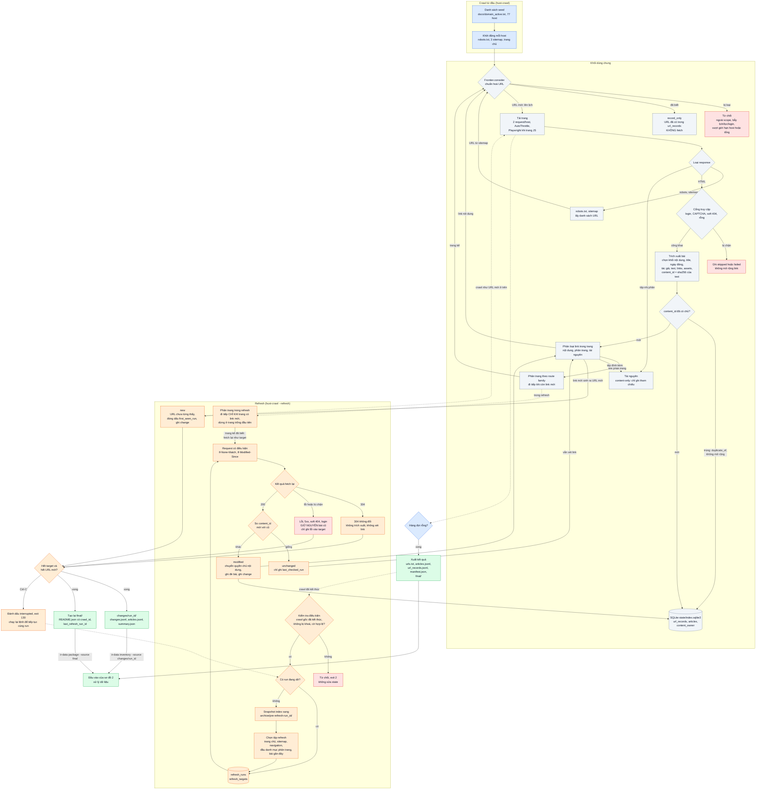

# Sơ đồ luồng dữ liệu

Hai sơ đồ nối với nhau: sơ đồ 1 **sinh ra** `final/` (và `changes/<run_id>/` khi refresh),
sơ đồ 2 **tiêu thụ** chúng để tạo corpus theo yêu cầu của thầy.

1. [Luồng crawl](#1-luồng-crawl-từ-đầu-và-crawl-tăng-dần): crawl từ đầu và phát hiện không crawl lại.
2. [Luồng xử lý dữ liệu](#2-luồng-xử-lý-dữ-liệu-theo-yêu-cầu-của-thầy): từ `final/` đến corpus, MongoDB và Kaggle.

---

## 1. Luồng crawl: từ đầu và crawl tăng dần

Hai chế độ của `hust-crawl` **dùng chung** khối Frontier, Tải trang và Xử lý trang; khác
nhau ở cách chọn URL đầu vào và cách xử lý URL đã biết.

- Màu xanh dương: crawl từ đầu.
- Màu cam: refresh (`--refresh`).
- Màu xám: khối dùng chung.
- Màu xanh lá: đầu ra.
- Màu đỏ: bị loại, lỗi hoặc từ chối.

### Điểm cần nhớ (crawl)

| Câu hỏi | Trả lời ngắn |
|---|---|
| Làm sao không fetch lại bài cũ? | `Frontier.consider` trả `record_only` cho URL chuẩn hoá đã có trong `url_records`. Chỉ tập hub và bài gần đây của refresh được fetch lại, bằng request riêng. |
| Làm sao biết bài bị sửa? | So `content_id` (sha256 của văn bản trích xuất) trước và sau khi fetch lại. Header `ETag`/`Last-Modified` giúp hub không đổi nhận 304. |
| Bài cũ có bị mất khi fetch lại lỗi? | Không. Lỗi, 5xx, soft 404, login chỉ ghi vào `refresh_targets`; bản cũ giữ nguyên. |
| Khi nào dừng? | Hàng đợi rỗng: hết target và không còn URL mới. Phân trang dừng ở trang đầu tiên không có link mới. Các giới hạn host/tổng vẫn là cầu chì. |
| Đầu ra của refresh? | `changes/<run_id>/` (`changes.jsonl`, `articles.jsonl`, `summary.json`) và `final/` được tạo lại đầy đủ. |

---

## 2. Luồng xử lý dữ liệu theo yêu cầu của thầy

Đầu vào là `final/` (và `changes/<run_id>/` sau mỗi lần refresh). Đầu ra là corpus có phiên bản,
được nhập vào MongoDB local và chia sẻ qua Kaggle. Mỗi yêu cầu của thầy là một nhánh có số
thứ tự, và kết thúc ở collection tương ứng.

Yêu cầu của thầy:

| # | Yêu cầu | Đầu ra | Collection Mongo |
|---|---|---|---|
| Y1 | Thuật toán tìm khối nội dung | mã `article.py`, báo cáo từ `ir-data evaluate-extraction` | không có (nằm trong crawl) |
| Y2 | Trang: tiêu đề, ngày đăng, tác giả, nội dung | `articles.jsonl` | `pages` |
| Y3 | Tài liệu: nội dung văn bản | `documents.jsonl` | `documents` |
| Y4 | Nguồn giới thiệu và văn bản liên kết (trang, tài liệu) | trường `referrers` và `links.jsonl` | `documents`, `links` |
| Y5 | Ảnh: nguồn giới thiệu | `images.jsonl` (chỉ URL) và cạnh `image` | `images`, `links` |
| Y6 | Đồ thị nguồn → đích kèm mô tả | `links.jsonl` | `links` |
| Y7 | MongoDB với lược đồ tự xây dựng | `compose.yaml`, `import-mongo`, `data-schema.md` | cả 5 collection |
| Y8 | Chia sẻ dữ liệu của project | dataset Kaggle public, `corpus.lock.json` | không có |

```mermaid
flowchart TD
    %% ============ ĐẦU VÀO ============
    IN["Đầu vào từ crawl<br/>final/articles.jsonl, urls.txt, README.json<br/>và changes/run_id sau mỗi refresh"]

    %% ============ Y1, Y2: TRANG ============
    subgraph PAGES["Y1, Y2: Trang web (làm trong lúc crawl, ghi vào articles.jsonl)"]
        direction TB
        ALGO["Y1: Thuật toán tìm khối nội dung<br/>ưu tiên article hoặc main,<br/>rồi id/class gợi ý;<br/>điểm = độ dài text + 80 x số đoạn<br/>trừ độ dài text trong link;<br/>loại menu, footer, sidebar;<br/>body chỉ là phương án cuối, kèm cảnh báo"]
        META["Y2: Metadata<br/>title: h1, rồi og:title, rồi title<br/>tác giả, ngày: meta, JSON-LD, microdata, byline<br/>không đoán khi thiếu, ghi cảnh báo khi xung đột"]
        REC["Bản ghi trang<br/>title, published_at, author,<br/>text, content_html, content_blocks,<br/>links kèm text, assets kèm alt và caption"]
        ALGO --> META --> REC
    end
    IN --> REC

    %% ============ INVENTORY ============
    subgraph ENRICH["Y3: Tài liệu (ir-data, tiếp tục được sau gián đoạn)"]
        direction TB
        INV["inventory<br/>đọc articles.jsonl theo luồng,<br/>lập danh sách tài liệu duy nhất theo URL<br/>và bảng refs: trang nguồn, anchor text"]
        WORK[("data/enrichment/state.sqlite3<br/>inventory, refs, parse_results,<br/>failures, cloud_jobs")]
        DL["download<br/>64 luồng toàn cục, 2 mỗi host,<br/>retry, nối tiếp bằng Range khi ETag mạnh,<br/>kiểm MIME từ nội dung, lưu theo sha256"]
        PARSE{"extract<br/>chọn parser theo định dạng"}
        PDF["PDF<br/>PyMuPDF"]
        WORD["DOCX: python-docx<br/>DOC: LibreOffice chuyển sang DOCX"]
        SHEET["XLSX, XLS<br/>openpyxl, xlrd"]
        SLIDE["PPTX: python-pptx<br/>PPT: LibreOffice chuyển sang PPTX"]
        CLOUD["LlamaParse fast<br/>chỉ cho trang PDF trực quan không có chữ,<br/>xoay key khi hết quota,<br/>trang trắng không gọi API"]
        RESULT["Kết quả mỗi URL<br/>text theo page, sheet, slide hoặc document,<br/>trạng thái, cảnh báo, phiên bản parser"]
        INV --> WORK
        WORK --> DL --> PARSE
        PARSE --> PDF
        PARSE --> WORD
        PARSE --> SHEET
        PARSE --> SLIDE
        PDF -- "không có chữ" --> CLOUD
        PDF --> RESULT
        WORD --> RESULT
        SHEET --> RESULT
        SLIDE --> RESULT
        CLOUD --> RESULT
        RESULT --> WORK
    end
    IN --> INV

    %% ============ Y4, Y5, Y6: ĐỒ THỊ ============
    subgraph LINKGRAPH["Y4, Y5, Y6: Liên kết, ảnh và đồ thị (build-graph)"]
        direction TB
        EDGES["Gom cạnh từ mỗi trang<br/>hyperlink kèm anchor text<br/>image và asset kèm alt, caption<br/>observed_refs"]
        DEDUP[("SQLite trên đĩa<br/>khử trùng theo<br/>nguồn, đích, quan hệ, anchor, alt, caption")]
        LINKS["Y6: links.jsonl<br/>source_url, target_url, relation,<br/>anchor_text, alt, caption<br/>nhiều mô tả khác nhau là nhiều cạnh"]
        IMAGES["Y5: images.jsonl<br/>chỉ danh mục URL ảnh,<br/>không tải ảnh; nguồn giới thiệu<br/>nằm ở cạnh image"]
        EDGES --> DEDUP --> LINKS
        DEDUP --> IMAGES
    end
    IN --> EDGES

    %% ============ ĐÓNG GÓI ============
    subgraph PACK["Đóng gói corpus (package, verify)"]
        direction TB
        GATE{"Enrichment xong chưa?<br/>không còn tải dở, file chưa parse,<br/>hay quota bị chặn"}
        DOCS["Y3, Y4: documents.jsonl<br/>url, sha256, mime, parts text,<br/>trạng thái, cảnh báo,<br/>referrers: trang nguồn và anchor text"]
        REPORT["extraction-report.json<br/>đã tải, đã parse, lỗi, chờ, byte"]
        MANIFEST["manifest.json<br/>sha256 từng file,<br/>snapshot_id = hash của danh sách file,<br/>status ready"]
        VERIFY{"verify<br/>đủ file, đúng size,<br/>đúng checksum, đúng snapshot_id?"}
        CORPUS["Corpus: data/corpus/latest<br/>articles, urls, README, documents,<br/>images, links, extraction-report, manifest"]
        GATE -- "chưa" --> STOP["Từ chối đóng gói<br/>nêu rõ phần còn dở"]
        GATE -- "rồi" --> DOCS --> REPORT --> MANIFEST --> VERIFY
        VERIFY -- "sai" --> BAD["Corpus không hợp lệ"]
        VERIFY -- "đúng" --> CORPUS
    end
    RESULT --> GATE
    REC --> GATE
    LINKS --> GATE
    IMAGES --> GATE

    %% ============ Y7: MONGODB ============
    subgraph MONGO["Y7: MongoDB local (Docker Compose, mongo 8)"]
        direction TB
        IMP["import-mongo<br/>verify trước khi nhập"]
        READY{"snapshot_id đã ready?"}
        STATUS["datasets: importing<br/>nhập theo lô, tối đa 100 bản ghi<br/>hoặc 4 MB mỗi lô"]
        COLS[("Collection, mỗi bản ghi mang snapshot_id,<br/>_id xác định nên nhập lại không nhân đôi<br/>pages, documents, images, links<br/>index theo snapshot_id, source_url, target_url")]
        DONE["datasets: ready<br/>lỗi thì ghi failed kèm lý do"]
        IMP --> READY
        READY -- "rồi" --> SKIP["Bỏ qua, idempotent"]
        READY -- "chưa" --> STATUS --> COLS --> DONE
    end
    CORPUS --> IMP

    %% ============ Y8: KAGGLE ============
    subgraph KAGGLE["Y8: Chia sẻ qua Kaggle (người vận hành chủ động chạy)"]
        direction TB
        PUB["publish<br/>dataset public, tạo version mới<br/>từ corpus đã verify"]
        LOCK["config/corpus.lock.json<br/>ghim owner, slug, version, snapshot_id"]
        PULL["pull theo lock<br/>thử tải cả gói, lỗi thì tải từng file"]
        PUB --> LOCK
        LOCK --> PULL
    end
    CORPUS --> PUB
    PULL -- "máy mới: không cần crawl lại" --> IMP

    %% ============ TIÊU THỤ ============
    subgraph USE["Tiêu thụ"]
        direction TB
        QUERY["Truy vấn và demo<br/>cạnh đi vào một trang hoặc tài liệu,<br/>văn bản của tài liệu,<br/>ảnh nằm trên trang nào"]
        LUCENE["lucene/<br/>lập chỉ mục và tìm kiếm<br/>từ corpus"]
    end
    COLS --> QUERY
    CORPUS --> LUCENE

    %% ============ MÀU ============
    classDef crawl fill:#dbeafe,stroke:#2563eb,color:#0f172a;
    classDef enrich fill:#ffedd5,stroke:#ea580c,color:#0f172a;
    classDef links fill:#ede9fe,stroke:#7c3aed,color:#0f172a;
    classDef pack fill:#f1f5f9,stroke:#64748b,color:#0f172a;
    classDef out fill:#dcfce7,stroke:#16a34a,color:#0f172a;
    classDef bad fill:#fee2e2,stroke:#dc2626,color:#0f172a;

    class IN,ALGO,META,REC crawl;
    class INV,WORK,DL,PARSE,PDF,WORD,SHEET,SLIDE,CLOUD,RESULT enrich;
    class EDGES,DEDUP,LINKS,IMAGES links;
    class GATE,DOCS,REPORT,MANIFEST,VERIFY pack;
    class CORPUS,COLS,DONE,PUB,LOCK,PULL,QUERY,LUCENE,IMP,READY,STATUS,SKIP out;
    class STOP,BAD bad;
```

### Điểm cần nhớ (xử lý dữ liệu)

| Câu hỏi | Trả lời ngắn |
|---|---|
| Ai làm Y1 và Y2? | Crawler, ngay lúc trích xuất bài. Kết quả đã nằm trong `articles.jsonl`, nên `ir-data` chỉ đọc lại. |
| Tài liệu được tải khi nào? | Sau crawl, trong `ir-data download`, chỉ cho tài liệu được trang tham chiếu. Crawl không tải tệp nhị phân. |
| Nguồn giới thiệu và anchor text lưu ở đâu? | Bảng `refs` lúc inventory, rồi thành `referrers` trong `documents.jsonl` và các dòng trong `links.jsonl`. Nhiều nguồn và nhiều mô tả được giữ riêng. |
| Ảnh có được tải không? | Không. Chỉ có danh mục URL và cạnh từ trang tham chiếu. |
| Sau một lần refresh thì làm gì? | Chạy `inventory --source changes/<run_id>` để chỉ nhận phần mới, rồi `download`, `extract`, `package --source final`. Tài liệu đã tải hoặc đã parse được bỏ qua nhờ checkpoint. |
| Chạy lại có hỏng dữ liệu không? | Không. `_id` xác định theo nội dung bản ghi và `snapshot_id`; snapshot đã `ready` thì bị bỏ qua. |
| Người mới clone làm gì? | `pull` theo `corpus.lock.json`, bật MongoDB, `import-mongo`, rồi truy vấn. Không phải crawl hay tải lại tài liệu. |

Nguồn thiết kế: `docs/superpowers/specs/2026-10-05-kaggle-mongodb-corpus-design.md` (corpus, Mongo, Kaggle)
và `docs/superpowers/specs/2026-10-06-incremental-refresh-crawl-design.md` (refresh).
